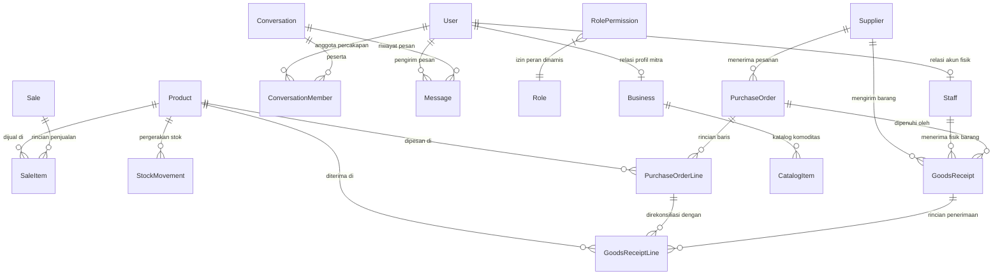

# 01-CONTRACT.MD — FORMAL SYSTEM ARCHITECTURE CONTRACT & SPECIFICATION
**Project**: Enterprise Overhaul Warung Madura Stock Manager  
**Version**: 2.1.0 (Enterprise Polish & Overhaul Hardened)  
**Author**: Worker 1 / Antigravity 1 (Lead Orchestrator & Master Architect — `ahmaddafa1017@gmail.com`)  
**Target Roles**: Worker 2 (Backend, Database & Seeding Specialist), Worker 3 (Frontend, UI/UX & Dark Mode Specialist)  
**Status**: APPROVED & LOCKED  

---

## 1. EXECUTIVE SUMMARY & SPRINT OBJECTIVES

Sistem **Warung Madura Stock Manager** telah melampaui fase foundational dengan stabilitas 100% pass-rate (108/108 unit & E2E tests). Pada fase **Polish & Overhaul**, sistem ditingkatkan menjadi standar visual korporat modern dan ramah evaluasi atasan (*Supervisor Evaluation Ready*):

1. **Brand Asset Contract**: Mengganti teks/badge inisial placeholder "WM" dengan foto otentik gerai fisik Warung Madura (`warung-madura-logo.jpg`) pada seluruh permukaan sistem.
2. **High-Contrast Dark Mode Contract**: Implementasi sistem tema gelap menyeluruh (*full dark mode*) dengan rasio kontras tinggi (WCAG AA/AAA compliant) dan tombol pengalih (*theme toggle*) yang elegan di sidebar header.
3. **Crisp SVG Iconography (Zero AI Slop / Zero Emoji)**: Menghapus 100% emoji unicode mentah (`👑`, `👤`, `📦`, `🛒`, `⚖️`, `🌱`, `🔒`, `📍`, `🗺️`) dan menggantikannya dengan ikon vektor presisi dari pustaka Lucide React.
4. **Comprehensive Evaluation Seed Dataset**: Menyediakan basis data simulasi lengkap yang mencakup seluruh status Purchase Order (`OPEN`, `PARTIAL`, `COMPLETE`, `CANCELLED`), seluruh variasi Goods Receipt (Normal, dengan Bonus, dengan Reject/Penyok), pergerakan stok historis, dan riwayat penjualan transaksi nyata.
5. **Zero-Regression Invariant**: Seluruh 108 pengujian Vitest dan alur transaksi ACID tetap lulus 100% tanpa kompromi.

---

## 2. POLISH & OVERHAUL ARCHITECTURAL DIRECTIVES

### 2.1 Brand Asset Contract (`warung-madura-logo.jpg`)
- **Asset URI**: `/warung-madura-logo.jpg` (Tersedia publik di direktori `client/public/warung-madura-logo.jpg` dan direktori asset `client/src/assets/warung-madura-logo.jpg`).
- **Surface Placement**:
  1. *Sidebar Brand Header*: Menggantikan kotak hijau teks `WM` dengan avatar foto otentik gerai Warung Madura ukuran 44x44px (`h-11 w-11`), `rounded-xl`, `object-cover`, dengan border halus `border-slate-200 dark:border-slate-700` dan efek bayangan `shadow-xs`.
  2. *Login Page Card*: Menampilkan foto Warung Madura ukuran 80x80px (`h-20 w-20`), `rounded-2xl`, `object-cover`, sebagai visual identity utama aplikasi.
  3. *Invoice / Slip Modal*: Menampilkan thumbnail logo pada header cetak struk/slip transaksi.
- **Aspect Ratio & Fallback Invariant**:
  - Wajib menggunakan `object-cover` dan `aspect-square`.
  - Dilengkapi atribut `alt="Warung Madura Berkah 24 Jam"`.

---

### 2.2 Polished High-Contrast Dark Mode Contract
Sistem tema menggunakan utilitas Tailwind CSS v4 `@custom-variant dark (&:where(.dark, .dark *));` dengan integrasi `ThemeContext`:
- **State Machine**:
  - Nilai: `'light'` atau `'dark'`.
  - Penyimpanan: `localStorage.getItem('wm_theme')`.
  - Fallback Otomatis: `window.matchMedia('(prefers-color-scheme: dark)').matches`.
  - Target DOM: Menambahkan atau menghapus class `dark` pada elemen root `<html>` (`document.documentElement`).
- **High-Contrast Color Tokens**:
  | Elemen UI | Light Mode Class | Dark Mode Class (High Contrast) |
  |---|---|---|
  | **Background Halaman** | `bg-slate-50` | `dark:bg-slate-950` |
  | **Sidebar & Navbar** | `bg-white border-slate-200` | `dark:bg-slate-900 dark:border-slate-800` |
  | **Card & Container** | `bg-white border-slate-200` | `dark:bg-slate-900/90 dark:border-slate-800` |
  | **Card Header / Muted** | `bg-slate-50 border-slate-200`| `dark:bg-slate-850 dark:bg-slate-900/50 dark:border-slate-800` |
  | **Teks Utama (Primary)** | `text-slate-900` | `dark:text-slate-100` |
  | **Teks Sekunder** | `text-slate-600` | `dark:text-slate-300` |
  | **Teks Muted / Label** | `text-slate-400` | `dark:text-slate-400` |
  | **Border Halus** | `border-slate-200` | `dark:border-slate-800` |
  | **Input & Dropdown** | `bg-white border-slate-300 text-slate-900` | `dark:bg-slate-800 dark:border-slate-700 dark:text-slate-100` |
  | **Badge Emerald (Success)**| `bg-emerald-50 text-emerald-700 border-emerald-200` | `dark:bg-emerald-950/60 dark:text-emerald-300 dark:border-emerald-800` |
  | **Badge Amber (Warning)** | `bg-amber-50 text-amber-700 border-amber-200` | `dark:bg-amber-950/60 dark:text-amber-300 dark:border-amber-800` |
  | **Badge Rose (Danger)** | `bg-rose-50 text-rose-700 border-rose-200` | `dark:bg-rose-950/60 dark:text-rose-300 dark:border-rose-800` |
  | **Badge Blue (Info)** | `bg-blue-50 text-blue-700 border-blue-200` | `dark:bg-blue-950/60 dark:text-blue-300 dark:border-blue-800` |
  | **Tabel Header (TH)** | `bg-slate-50 text-slate-500` | `dark:bg-slate-800/80 dark:text-slate-300` |
  | **Tabel Baris Hover** | `hover:bg-slate-50/70` | `dark:hover:bg-slate-800/50` |
- **Theme Toggle Component**:
  - Ditempatkan di header/sidebar berdampingan dengan profil pengguna.
  - Memakai icon Lucide: `Sun` saat dark mode aktif (klik untuk ubah ke light) dan `Moon` saat light mode aktif (klik untuk ubah ke dark).
  - Dilengkapi label tooltip dan transisi halus `transition-colors duration-150`.

---

### 2.3 Crisp Iconography Standard (Zero-Emoji Policy)
Seluruh penggunaan emoji grafis berbasis teks (Unicode Emoji) dilarang keras di seluruh file kode antarmuka. Semua simbol visual wajib menggunakan komponen SVG murni dari **`lucide-react`**:

| Emoji Lama | Komponen Lucide React Pengganti | Context Penggunaan |
|---|---|---|
| `👑` | `<Crown className="h-3.5 w-3.5 text-amber-500 shrink-0" />` | Badge & Tombol Role Pemilik (Cak Rofi) |
| `👤` | `<User className="h-3.5 w-3.5 text-blue-500 shrink-0" />` | Badge & Tombol Role Staf (Udin, Sari) |
| `📦` | `<Package className="h-4 w-4 text-emerald-500 shrink-0" />` | Tab Filter Barang Masuk & Entitas Produk |
| `🛒` | `<ShoppingCart className="h-4 w-4 text-blue-500 shrink-0" />` | Tab Filter Penjualan & Menu Kasir POS |
| `⚖️` | `<Scale className="h-4 w-4 text-amber-500 shrink-0" />` | Tab Filter Koreksi Stok (Stock Adjustment) |
| `🌱` | `<Sprout className="h-4 w-4 text-emerald-600 shrink-0" />` | Tab Filter Stok Awal (Initial Stock) |
| `🔒` | `<Lock className="h-3.5 w-3.5 text-slate-400 shrink-0" />` | Indikator Sensor/Masking HPP Modal & Omset |
| `📍` | `<MapPin className="h-3.5 w-3.5 text-rose-500 shrink-0" />` | Penanda Lokasi Mitra & Desa |
| `🗺️` | `<Map className="h-3.5 w-3.5 text-blue-500 shrink-0" />` | Tombol Tautan Google Maps |
| `🎁` | `<Gift className="h-3.5 w-3.5 text-emerald-600 shrink-0" />` | Indikator Barang Bonus Penerimaan |
| `❌` / `⚠️` | `<AlertTriangle className="h-3.5 w-3.5 text-rose-500 shrink-0" />` | Indikator Barang Reject / Rusak |
| `✨` | `<Sparkles className="h-3 w-3 text-amber-500 shrink-0" />` | Header Demo Switcher |

---

### 2.4 Comprehensive Dummy Data Matrix (Supervisor Ready)
Untuk memenuhi evaluasi menyeluruh dari atasan/penguji (*Supervisor Evaluation*), file seed database (`server/prisma/seed.ts`) dikonfigurasikan memuat dataset lengkap:

#### A. Varian Purchase Order (PO):
1. **`PO-20261020-0001` (Status: `OPEN`)**:
   - Supplier: *PT Sembako Nusantara Jaya*
   - Produk: Beras 5 kg (10 sak) & Minyak Goreng 1L (24 botol).
   - Kondisi: Pesanan baru diterbitkan, belum ada penerimaan barang sama sekali (`fulfilledBase = 0`).
2. **`PO-20261021-0002` (Status: `PARTIAL`)**:
   - Supplier: *Grosir Berkah Sembako*
   - Produk: Indomie Goreng (5 dus = 200 bks) & Kopi Sachet (4 renteng = 40 sachet).
   - Kondisi: Sebagian barang telah diterima (Indomie diterima 3 dus / 120 bks), sisa 2 dus masih terbuka (`OPEN`).
3. **`PO-20261022-0003` (Status: `COMPLETE`)**:
   - Supplier: *Distributor Kopi & Minuman Sejahtera*
   - Produk: Aqua 600 ml (5 dus = 120 botol) & Teh Botol (48 botol).
   - Kondisi: Seluruh pesanan telah diterima tuntas 100% melalui penerimaan barang.
4. **`PO-20261023-0004` (Status: `CANCELLED`)**:
   - Supplier: *CV Surya Madura Abadi*
   - Produk: Biskuit Kaleng (20 kaleng).
   - Kondisi: Dibatalkan oleh Pemilik karena `cancelReason: "Distributor kehabisan stok pabrik"`.

#### B. Varian Goods Receipt (Penerimaan Barang):
1. **Penerimaan Standar / Normal (`GR-20261021-0001`)**:
   - Berasal dari PO Parsial. Menerima 3 dus Indomie tepat 120 bungkus tanpa bonus atau reject.
2. **Penerimaan dengan Bonus (`GR-20261022-0002`)**:
   - Berasal dari PO Complete. Menerima 5 dus Aqua + BONUS 12 botol gratis dari promo distributor (`bonusBase = 12`).
   - Dampak: Stok bertambah `120 + 12 = 132 botol`, audit trail mencatat bonus.
3. **Penerimaan dengan Barang Reject / Rusak (`GR-20261022-0003`)**:
   - Menerima pesanan Teh Botol sebanyak 48 botol.
   - Ditemukan 4 botol rusak/pecah saat pengiriman (`rejectedBase = 4`, `rejectReason = PENYOK`, `rejectNote = "Pecah saat penurunan dari truk distributor"`).
   - Dampak: Hanya 44 botol yang masuk ke stok siap jual, 4 botol ditolak dan dicatat pada audit trail logistik.

#### C. Riwayat Mutasi Stok (Stock Movements):
- Mencakup seluruh tipe mutasi:
  - `INITIAL`: Stok awal pendirian sistem.
  - `RECEIPT`: Penerimaan barang masuk dari PO.
  - `SALE`: Pengurangan otomatis dari transaksi kasir.
  - `ADJUSTMENT_IN`: Koreksi penambahan hasil audit stok opname fisik.
  - `ADJUSTMENT_OUT`: Koreksi pengurangan barang rusak/bocor di rak toko.
- **Integritas Mutasi**: `afterStock = beforeStock ± quantity` berlaku konsisten pada 100% baris data.

#### D. Riwayat Penjualan (Sales History):
- Transaksi riil terdistribusi selama 3 hari terakhir hingga hari ini dengan beragam komoditas (Sembako, Minuman, Makanan Instan, Rokok).

---

## 3. RELATIONAL DATABASE SPECIFICATION (3NF)

Database menggunakan **PostgreSQL 15+** yang dikelola melalui **Prisma 6 ORM**. Semua tabel memenuhi Normal Form ke-3 (3NF) dengan snapshot historis yang terisolasi secara terkendali.



### 3.1 Enums

| Enum Name | Values | Keterangan |
|---|---|---|
| `Role` | `PEMILIK`, `STAF` | Peran hak akses sistem. |
| `StockMovementType` | `INITIAL`, `SALE`, `ADJUSTMENT_IN`, `ADJUSTMENT_OUT`, `RECEIPT` | Klasifikasi mutasi stok. |
| `StockAdjustmentReason` | `HITUNG_ULANG`, `RUSAK`, `KEDALUWARSA`, `HILANG`, `LAINNYA` | Alasan koreksi stok manual. |
| `PurchaseOrderStatus` | `OPEN`, `PARTIAL`, `COMPLETE`, `CANCELLED` | Status siklus hidup PO. |
| `GoodsReceiptRejectReason`| `PENYOK`, `KEDALUWARSA`, `LAINNYA` | Alasan penolakan barang datang. |
| `BusinessSource` | `SELF`, `DINAS` | Asal data direktori bisnis. |

---

### 3.2 Tabel Entitas & Kolom Relasional

#### A. `Product`
- `id`: UUID (PK)
- `sku`: VARCHAR(50) (UNIQUE, NOT NULL)
- `name`: VARCHAR(255) (NOT NULL)
- `category`: VARCHAR(100) (NOT NULL)
- `purchasePrice`: DECIMAL(12, 2) (NOT NULL)
- `sellingPrice`: DECIMAL(12, 2) (NOT NULL)
- `stock`: INTEGER (NOT NULL, DEFAULT 0, CHECK: `stock >= 0`)
- `isActive`: BOOLEAN (NOT NULL, DEFAULT true)
- `baseUnit`: VARCHAR(20) (NOT NULL, DEFAULT "pcs")
- `purchaseUnit`: VARCHAR(20) (NOT NULL, DEFAULT "pcs")
- `unitsPerPurchaseUnit`: INTEGER (NOT NULL, DEFAULT 1, CHECK: `unitsPerPurchaseUnit >= 1`)
- `createdAt`: TIMESTAMPTZ (NOT NULL, DEFAULT now())
- `updatedAt`: TIMESTAMPTZ (NOT NULL, auto-updated)
- **Indexes**: `@@unique([sku])`

#### B. `Supplier`
- `id`: UUID (PK)
- `name`: VARCHAR(150) (UNIQUE, NOT NULL)
- `phone`: VARCHAR(50) (NULLABLE)
- `isActive`: BOOLEAN (NOT NULL, DEFAULT true)
- `createdAt`: TIMESTAMPTZ (NOT NULL, DEFAULT now())

#### C. `Staff`
- `id`: UUID (PK)
- `name`: VARCHAR(100) (UNIQUE, NOT NULL)
- `isActive`: BOOLEAN (NOT NULL, DEFAULT true)
- `createdAt`: TIMESTAMPTZ (NOT NULL, DEFAULT now())

#### D. `User`
- `id`: UUID (PK)
- `username`: VARCHAR(50) (UNIQUE, NOT NULL)
- `name`: VARCHAR(100) (NOT NULL)
- `passwordHash`: VARCHAR(255) (NOT NULL)
- `role`: Role Enum (NOT NULL, DEFAULT STAF)
- `staffId`: UUID (UNIQUE, NULLABLE, FK -> `Staff.id` ON DELETE SET NULL)
- `isActive`: BOOLEAN (NOT NULL, DEFAULT true)
- `createdAt`: TIMESTAMPTZ (NOT NULL, DEFAULT now())
- `updatedAt`: TIMESTAMPTZ (NOT NULL, auto-updated)
- **Indexes**: `@@unique([username])`, `@@index([role])`

#### E. `RolePermission`
- `id`: UUID (PK)
- `role`: Role Enum (NOT NULL)
- `permission`: VARCHAR(50) (NOT NULL)
- `createdAt`: TIMESTAMPTZ (NOT NULL, DEFAULT now())
- **Indexes**: `@@unique([role, permission])`, `@@index([role])`

#### F. `PurchaseOrder`
- `id`: UUID (PK)
- `orderNumber`: VARCHAR(50) (UNIQUE, NOT NULL) — format: `PO-YYYYMMDD-NNNN`
- `supplierId`: UUID (NOT NULL, FK -> `Supplier.id` ON DELETE RESTRICT)
- `orderedAt`: TIMESTAMPTZ (NOT NULL, DEFAULT now())
- `note`: TEXT (NULLABLE)
- `status`: PurchaseOrderStatus Enum (NOT NULL, DEFAULT OPEN)
- `cancelReason`: TEXT (NULLABLE)
- `createdAt`: TIMESTAMPTZ (NOT NULL, DEFAULT now())
- **Indexes**: `@@unique([orderNumber])`, `@@index([supplierId])`, `@@index([createdAt])`

#### G. `PurchaseOrderLine`
- `id`: UUID (PK)
- `purchaseOrderId`: UUID (NOT NULL, FK -> `PurchaseOrder.id` ON DELETE CASCADE)
- `productId`: UUID (NOT NULL, FK -> `Product.id` ON DELETE RESTRICT)
- `orderedBase`: INTEGER (NOT NULL) — total dipesan dalam satuan dasar
- `fulfilledBase`: INTEGER (NOT NULL, DEFAULT 0) — total telah diterima
- `cancelledBase`: INTEGER (NOT NULL, DEFAULT 0) — total dibatalkan
- `purchaseUnit`: VARCHAR(20) (NOT NULL)
- `unitsPerPurchaseUnit`: INTEGER (NOT NULL)
- `createdAt`: TIMESTAMPTZ (NOT NULL, DEFAULT now())
- **Indexes**: `@@unique([purchaseOrderId, productId])`, `@@index([purchaseOrderId])`, `@@index([productId])`

#### H. `GoodsReceipt`
- `id`: UUID (PK)
- `receiptNumber`: VARCHAR(50) (UNIQUE, NOT NULL) — format: `GR-YYYYMMDD-NNNN`
- `idempotencyKey`: VARCHAR(100) (UNIQUE, NOT NULL)
- `purchaseOrderId`: UUID (NULLABLE, FK -> `PurchaseOrder.id` ON DELETE RESTRICT)
- `supplierId`: UUID (NOT NULL, FK -> `Supplier.id` ON DELETE RESTRICT)
- `receivedById`: UUID (NOT NULL, FK -> `Staff.id` ON DELETE RESTRICT)
- `receivedAt`: TIMESTAMPTZ (NOT NULL, DEFAULT now())
- `note`: TEXT (NULLABLE)
- `createdAt`: TIMESTAMPTZ (NOT NULL, DEFAULT now())
- **Indexes**: `@@unique([receiptNumber])`, `@@unique([idempotencyKey])`, `@@index([supplierId])`, `@@index([receivedById])`, `@@index([purchaseOrderId])`, `@@index([createdAt])`

#### I. `GoodsReceiptLine`
- `id`: UUID (PK)
- `goodsReceiptId`: UUID (NOT NULL, FK -> `GoodsReceipt.id` ON DELETE CASCADE)
- `productId`: UUID (NOT NULL, FK -> `Product.id` ON DELETE RESTRICT)
- `purchaseOrderLineId`: UUID (NULLABLE, FK -> `PurchaseOrderLine.id` ON DELETE RESTRICT)
- `receivedBase`: INTEGER (NOT NULL) — fisik diterima masuk stok
- `rejectedBase`: INTEGER (NOT NULL, DEFAULT 0) — fisik ditolak rusak
- `rejectReason`: GoodsReceiptRejectReason Enum (NULLABLE)
- `rejectNote`: TEXT (NULLABLE)
- `bonusBase`: INTEGER (NOT NULL, DEFAULT 0) — bonus ekstra masuk stok
- `purchaseUnit`: VARCHAR(20) (NOT NULL)
- `unitsPerPurchaseUnit`: INTEGER (NOT NULL)
- `unitCostPerPurchaseUnit`: DECIMAL(12, 2) (NOT NULL) — snapshot HPP modal terkunci
- `createdAt`: TIMESTAMPTZ (NOT NULL, DEFAULT now())
- **Indexes**: `@@index([goodsReceiptId])`, `@@index([productId])`, `@@index([purchaseOrderLineId])`

#### J. `Sale` & `SaleItem`
- `Sale`: `id` (UUID PK), `invoiceNumber` (VARCHAR(50) UNIQUE), `total` (DECIMAL(12, 2)), `createdAt` (TIMESTAMPTZ)
- `SaleItem`: `id` (UUID PK), `saleId` (FK -> `Sale.id` ON DELETE CASCADE), `productId` (FK -> `Product.id` ON DELETE RESTRICT), `quantity` (INTEGER), `unitPrice` (DECIMAL(12, 2)), `subtotal` (DECIMAL(12, 2))

#### K. `StockMovement`
- `id`: UUID (PK)
- `productId`: UUID (NOT NULL, FK -> `Product.id` ON DELETE RESTRICT)
- `type`: StockMovementType Enum (NOT NULL)
- `quantity`: INTEGER (NOT NULL)
- `beforeStock`: INTEGER (NOT NULL)
- `afterStock`: INTEGER (NOT NULL)
- `referenceType`: VARCHAR(50) (NULLABLE)
- `referenceId`: VARCHAR(100) (NULLABLE)
- `reason`: StockAdjustmentReason Enum (NULLABLE)
- `note`: TEXT (NULLABLE)
- `createdAt`: TIMESTAMPTZ (NOT NULL, DEFAULT now())
- **Indexes**: `@@index([productId, createdAt])`

---

## 4. BACKEND & FRONTEND API CONTRACT

### 4.1 Ringkasan Endpoint & RBAC Masking Matrix

| Method | Endpoint | Izin Akses Minimum | Masking Finansial | Deskripsi |
|---|---|---|---|---|
| `POST` | `/api/auth/login` | Publik (Rate-limited) | - | Login via Username & PIN |
| `GET` | `/api/auth/me` | `requireAuth` | - | Profil sesi aktif & daftar izin |
| `GET` | `/api/permissions` | `requireAuth` | - | Matriks izin peran dinamis |
| `PUT` | `/api/permissions/:role` | `PEMILIK` | - | Perbarui daftar izin peran |
| `GET` | `/api/products` | `product:read` | `cost:view` (`purchasePrice: null`) | Katalog produk |
| `POST` | `/api/products` | `product:manage` | - | Tambah produk baru |
| `GET` | `/api/purchase-orders` | `purchase_order:read` | - | Daftar Purchase Order |
| `POST` | `/api/purchase-orders` | `purchase_order:manage`| - | Buat Purchase Order baru |
| `POST` | `/api/purchase-orders/:id/cancel-remaining` | `purchase_order:manage` | - | Batalkan sisa barang PO |
| `GET` | `/api/goods-receipts` | `goods_receipt:read` | `cost:view` | Riwayat barang masuk |
| `POST` | `/api/goods-receipts` | `goods_receipt:create`| Anti-Impersonasi + Idempotent | Catat barang masuk fisik |
| `GET` | `/api/sales` | `sales:manage` / `dashboard:financial` | - | Riwayat transaksi kasir |
| `POST` | `/api/sales` | `sales:manage` | - | Transaksi kasir POS baru |
| `GET` | `/api/stock-movements` | `stock:read` | - | Audit trail mutasi stok |
| `POST` | `/api/stock-adjustments` | `stock:adjust` | - | Koreksi stok fisik manual |
| `GET` | `/api/dashboard` | `requireAuth` | `dashboard:financial` | Ringkasan metrik & omset |

---

### 4.2 Skema DTO & Payload Kontrak Baku

#### A. Endpoint `POST /api/auth/login`
- **Request**:
  ```json
  {
    "username": "cakrofi",
    "password": "PIN"
  }
  ```
- **Response 200 OK**:
  ```json
  {
    "token": "eyJhbGciOiJIUzI1NiIsIn...",
    "user": {
      "id": "e4575ec2-c515-46b0-8dbb-149b183ce527",
      "username": "cakrofi",
      "name": "Cak Rofi (Pemilik)",
      "role": "PEMILIK",
      "staffId": null
    },
    "permissions": ["cost:view", "dashboard:financial", "..."]
  }
  ```
- **Error Codes**: `400 Bad Request`, `401 Unauthorized` ("Kredensial tidak valid"), `429 Too Many Requests` (Brute force protection: > 5x salah = lock 15 menit).

#### B. Endpoint `GET /api/products`
- **Header**: `Authorization: Bearer <token>`
- **Response 200 (Dengan Izin `cost:view`)**:
  ```json
  [
    {
      "id": "c138ce3d-fec3-44df-9e23-28828aeae9b7",
      "sku": "MIE-001",
      "name": "Indomie Goreng",
      "category": "Makanan Instan",
      "purchasePrice": 2800,
      "sellingPrice": 3500,
      "stock": 140,
      "baseUnit": "bungkus",
      "purchaseUnit": "dus",
      "unitsPerPurchaseUnit": 40,
      "isActive": true
    }
  ]
  ```
- **Response 200 (Masked: Tanpa Izin `cost:view`)**:
  ```json
  [
    {
      "id": "c138ce3d-fec3-44df-9e23-28828aeae9b7",
      "sku": "MIE-001",
      "name": "Indomie Goreng",
      "category": "Makanan Instan",
      "purchasePrice": null,
      "sellingPrice": 3500,
      "stock": 140,
      "baseUnit": "bungkus",
      "purchaseUnit": "dus",
      "unitsPerPurchaseUnit": 40,
      "isActive": true
    }
  ]
  ```

#### C. Endpoint `POST /api/goods-receipts`
- **Header**: `Authorization: Bearer <token>`
- **Request Payload**:
  ```json
  {
    "idempotencyKey": "gr-20261023-req-001",
    "purchaseOrderId": "a1b2c3d4-...",
    "supplierId": "s1s2s3s4-...",
    "receivedById": "f1f2f3f4-...",
    "receivedAt": "2026-10-23T10:00:00Z",
    "note": "Kiriman truk pagi",
    "lines": [
      {
        "purchaseOrderLineId": "pol-1...",
        "productId": "p1...",
        "purchaseQuantity": 5,
        "bonusPurchaseQuantity": 1,
        "rejectedPurchaseQuantity": 0,
        "unitCostPerPurchaseUnit": 112000
      }
    ]
  }
  ```
- **Aturan Validasi & Invariant**:
  - *Anti-Impersonasi Staf*: Jika pengirim bertindak sebagai `STAF`, maka `receivedById` **wajib** sama persis dengan `req.user.staffId`. Pelanggaran ditolak dengan `403 Forbidden`.
  - *Idempotency*: Jika `idempotencyKey` yang sama dikirim ulang, server mengembalikan data penerimaan sebelumnya secara identik (HTTP 200 OK) tanpa membuat duplikasi stok.

#### D. Endpoint `GET /api/dashboard`
- **Response 200 (Dengan Izin `dashboard:financial`)**:
  ```json
  {
    "totalProducts": 10,
    "totalUnits": 520,
    "todaySalesTotal": 1450000,
    "lowStockCount": 2,
    "lowStockThreshold": 5,
    "latestSales": [...],
    "lowStockProducts": [...]
  }
  ```
- **Response 200 (Masked: Tanpa Izin `dashboard:financial`)**:
  ```json
  {
    "totalProducts": 10,
    "totalUnits": 520,
    "todaySalesTotal": null,
    "lowStockCount": 2,
    "lowStockThreshold": 5,
    "latestSales": [],
    "lowStockProducts": [...]
  }
  ```

---

## 5. TEST MATRIX & ZERO-REGRESSION INVARIANT

Seluruh pekerja sistem wajib memverifikasi bahwa test suite berikut tetap berjalan dengan **100% kelulusan**:

| Test Suite File | Ruang Lingkup Verifikasi | Jumlah Test | Target Status |
|---|---|---|---|
| `server/test/e2e-api.test.ts` | S1–S20 via E2E REST API (Konversi, Parsial, Bonus, Reject, Idempotency) | 20 tests | 100% PASS |
| `server/test/scenarios.test.ts` | Servis Unit & Logika Bisnis (HPP snapshot, Mutasi Stok, Transisi Status PO) | 20 tests | 100% PASS |
| `server/test/rbac-comprehensive.test.ts` | Granular Dynamic RBAC, Masking Sensor, Mutasi Izin | 14 tests | 100% PASS |
| `server/test/boundary-edge-adversarial.test.ts` | SQL Injection immunity, Duplikasi SKU/Staf, Nilai batas | 13 tests | 100% PASS |
| `server/test/unit-business-logic.test.ts` | Unit validator Zod, Formatting Tanggal/Rupiah, Konversi Satuan | 13 tests | 100% PASS |
| `server/test/k1-k17.test.ts` | Scraper Direktori Dinas, Sensor UU PDP, Haversine Nearby, Realtime Chat | 13 tests | 100% PASS |
| `server/test/rbac.test.ts` | Login PIN token, Anti-impersonasi staf, DTO Sanitization | 8 tests | 100% PASS |
| `server/test/acid-transactions.test.ts` | Database Rollback, Isolasi Transaksi, Pencegahan Race Condition Overselling | 6 tests | 100% PASS |
| `server/test/t1-t11.test.ts` | Validasi Integritas Data & Database Check Constraints | 1 test (11 asserts) | 100% PASS |
| **TOTAL** | **Enterprise Test Automation Suite** | **108 tests** | **100% PASS** |

---

## 6. WORKER DELEGATION & TASK DISPATCH

### 6.1 Worker 2 (Backend, Database & Comprehensive Seeding Specialist)
- **Target File**: `server/prisma/seed.ts` (didukung `server/prisma/seed-defaults.ts`).
- **Tugas Utama**:
  1. Buat dataset Purchase Order komprehensif mencakup 4 status lengkap: `OPEN`, `PARTIAL`, `COMPLETE`, dan `CANCELLED`.
  2. Buat dataset Goods Receipt mencakup 3 variasi riil: Normal, dengan Bonus (`bonusBase > 0`), dan dengan Reject (`rejectedBase > 0`, `rejectReason = PENYOK`).
  3. Hubungkan Goods Receipt dengan Purchase Order terkait sehingga status PO otomatis terefleksi secara transaksional (`PARTIAL` dan `COMPLETE`).
  4. Perluas Stock Movements agar mencatat seluruh varian transaksi (`INITIAL`, `RECEIPT`, `SALE`, `ADJUSTMENT_IN`, `ADJUSTMENT_OUT`) dengan matematis integritas mutasi yang tepat.
  5. Perluas riwayat transaksi kasir (`Sale` & `SaleItem`) agar grafik Dashboard terisi data historis realistis.
  6. Eksekusi pengujian otomatis: Jalankan `npm test` untuk memastikan 108/108 tes Vitest tetap hijau sempurna.

### 6.2 Worker 3 (Frontend, UI/UX, Dark Mode & Crisp Iconography Specialist)
- **Target Files**:
  - `client/src/components/Layout.tsx`
  - `client/src/pages/LoginPage.tsx`
  - `client/src/pages/StockHistoryPage.tsx`
  - `client/src/pages/DashboardPage.tsx`
  - `client/src/pages/GoodsReceiptsPage.tsx`
  - `client/src/components/ChatWidget.tsx`
  - `client/src/components/PageHeader.tsx`
  - `client/src/components/ui.ts`
- **Tugas Utama**:
  1. *Brand Logo Integration*: Ganti inisial `WM` pada `Layout.tsx` dan `LoginPage.tsx` dengan `/warung-madura-logo.jpg`.
  2. *High-Contrast Dark Mode*:
     - Tambahkan tombol Theme Toggle di sidebar header `Layout.tsx` menggunakan `Sun` dan `Moon` dari Lucide React.
     - Poles seluruh halaman (Dashboard, Produk, PO, Barang Masuk, Kasir, Riwayat Stok & Penjualan) agar memiliki kontras tinggi yang tajam di mode gelap tanpa teks kabur.
  3. *Zero-Emoji Clean-up*:
     - Ganti `👑 Rofi` -> `<Crown className="h-3 w-3 text-amber-500 inline mr-1" /> Rofi`
     - Ganti `👤 Udin` -> `<User className="h-3 w-3 text-blue-500 inline mr-1" /> Udin`
     - Ganti `👤 Sari` -> `<User className="h-3 w-3 text-blue-500 inline mr-1" /> Sari`
     - Ganti emoji filter di `StockHistoryPage.tsx` (`📦`, `🛒`, `⚖️`, `🌱`) dengan komponen Lucide (`Package`, `ShoppingCart`, `Scale`, `Sprout`).
     - Ganti emoji `🔒` di `DashboardPage.tsx` & `GoodsReceiptsPage.tsx` dengan `<Lock className="h-3.5 w-3.5" />`.
     - Ganti emoji `📍` dan `🗺️` di `ChatWidget.tsx` dengan `<MapPin />` dan `<Map />`.
  4. Jalankan `npm run build` untuk memverifikasi tidak ada error TypeScript maupun bundle Vite.
