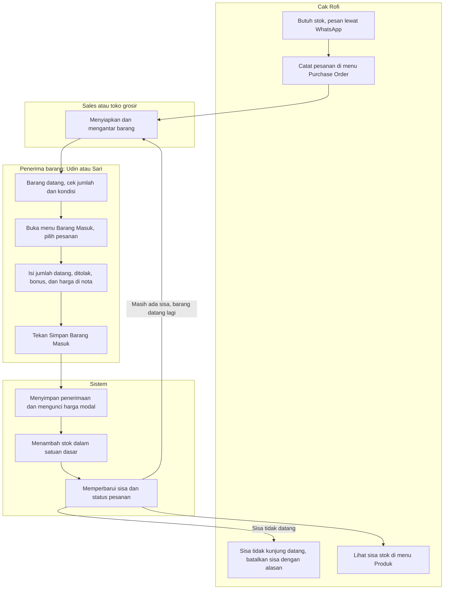
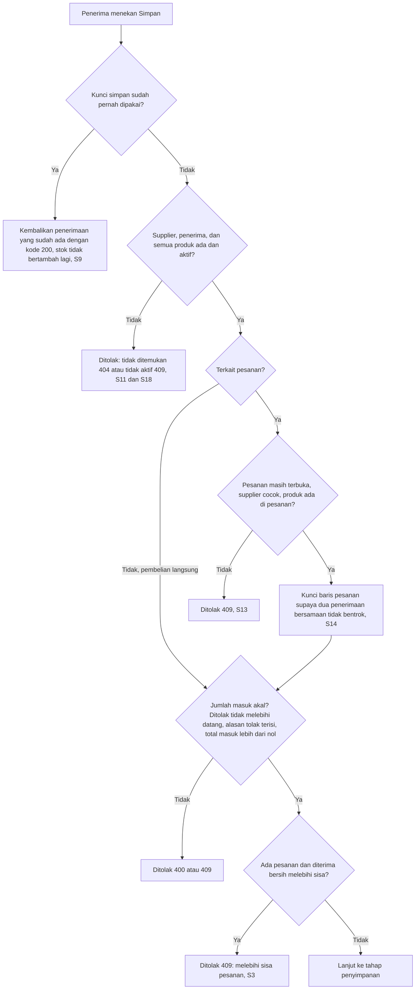
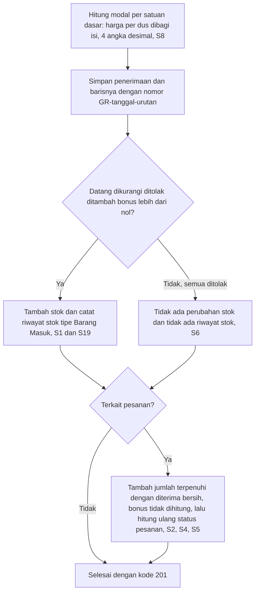
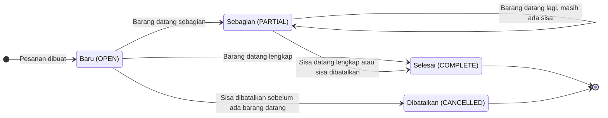
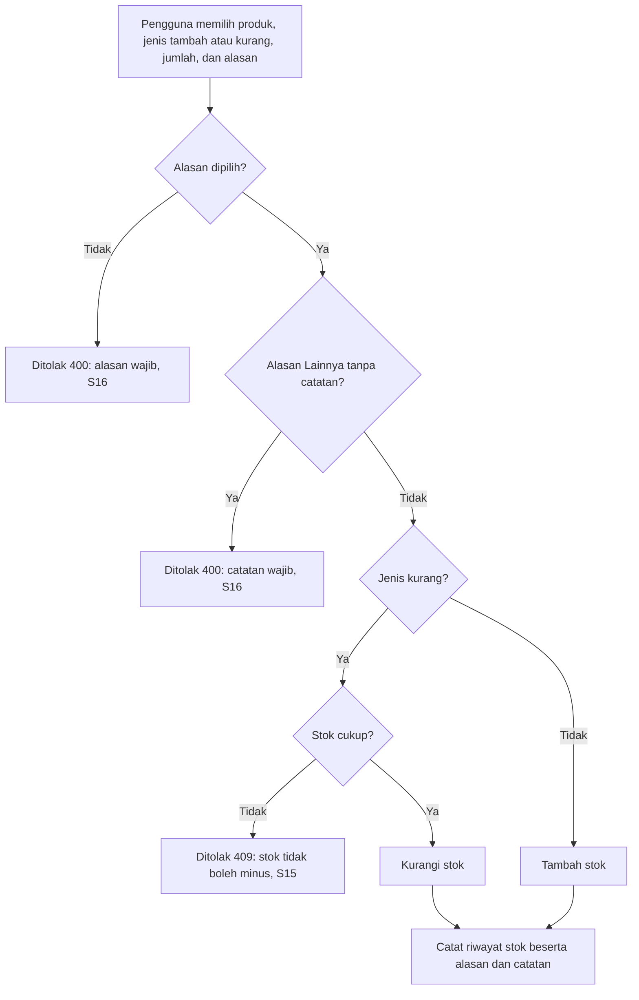
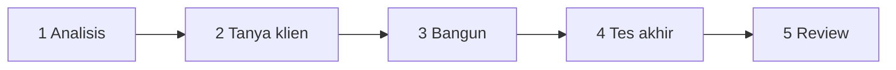
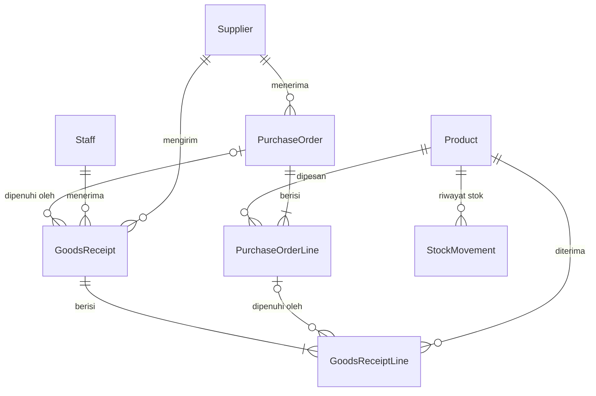
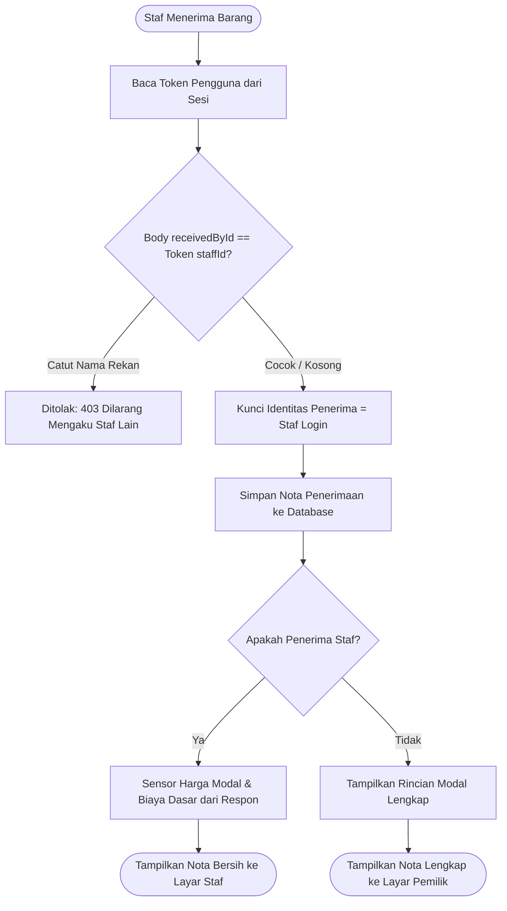

# Dokumentasi Proyek: Modul Restock dan Inventory Warung Madura

**Klien:** Cak Rofi, pemilik Warung Madura "Berkah 24 Jam"
**Aplikasi:** Warung Madura Stock Manager (project latihan DevSprint Accelerator, Warung Mission)
**Tanggal dokumen:** 10 Oktober 2026

---

## 0. Cara membaca dokumen ini

| Pembaca | Bagian yang dibaca |
| --- | --- |
| Atasan | 1, 2, 3, 7, 8 |
| Tim non-teknis | 1 sampai 4, dan 9 |
| Developer | Semua bagian |

Bagian 1 sampai 4 ditulis tanpa istilah teknis. Mulai bagian 5 isinya teknis. Istilah yang belum familiar dijelaskan di Glosarium (bagian 12).

**Dasar dokumen ini.** Isinya disusun dari kode yang ada di folder project, `FINAL_TEST.md`, `REVIEW.md`, dan `progres.md`. Folder ini belum memakai git, jadi daftar perubahan diambil dari tanggal file dan pembacaan kode. Sebelum dokumen ini ditulis, typecheck (pemeriksaan tipe data) server dan client serta lint (pemeriksa gaya kode) dijalankan ulang dan lulus. Test otomatis dan build tidak dijalankan ulang untuk dokumen ini, karena butuh database. Hasil keduanya diambil dari `FINAL_TEST.md`. Tampilan layar belum dicoba di browser, hanya dibaca dari kodenya.

---

## 1. Ringkasan

Cak Rofi mencatat barang masuk di buku tulis, dan catatan itu sering tidak cocok dengan barang di rak. Penyebabnya: barang datang kurang atau terlambat, ada bonus dan barang rusak, satuan beli (dus, renteng, bal) berbeda dari satuan jual, dan pernah tersimpan dobel karena tombol tertekan dua kali.

Solusinya dua modul:
- **Restock** (baru): mencatat supplier, pesanan, dan penerimaan barang. Penerimaan bisa bertahap, bisa ada bonus, bisa ada barang ditolak, selalu tercatat siapa penerimanya, dan harga modal terkunci pada hari barang datang.
- **Inventory** (sudah ada, diperkuat): stok sekarang punya satuan (dus 40 bungkus, dst.), tampil dengan nama satuannya, dan koreksi stok wajib beralasan.

**Status akhir:** 20 dari 20 skenario uji lulus (`FINAL_TEST.md`). Dari 12 permintaan Cak Rofi, 11 selesai dan 1 sebagian (barang rusak dan klaim ke sales).

**Tiga hal yang perlu diketahui atasan:**
1. Semua aturan bisnis memakai nilai usulan tim. Pertanyaan ke Cak Rofi belum dijawab, jadi belum ada yang dikonfirmasi klien.
2. Di layar, barang ditolak dan bonus baru bisa dicatat dalam dus utuh. Mencatat "2 bungkus penyok" baru bisa lewat API (jalur teknis di belakang layar).
3. Penerimaan yang sudah tersimpan tidak bisa diubah atau dibatalkan, dan pemilihan penerima belum memakai login.

---

## 2. Latar belakang dan "Sebelum vs Sesudah"

Cak Rofi memesan barang ke sales Pak Haji dan toko grosir lewat WhatsApp, lalu barang diantar. Penerimanya Udin (pagi) atau Sari (malam). Semuanya dicatat di buku tulis.

Contoh yang sering terjadi: pesan 5 dus mie, datang 3 dus, sisanya besok. Kadang sisanya tidak datang sama sekali. Kadang ada bonus (beli 10 gratis 1), kadang ada barang penyok atau kedaluwarsa. Harga dari sales juga bisa naik tiba-tiba, dan Cak Rofi ingin tahu modal per bungkus pada hari barang itu datang.

| Hal | Sebelum (buku tulis) | Sesudah (aplikasi) |
| --- | --- | --- |
| Mencatat pesanan | Hanya di chat WhatsApp | Dicatat di menu Purchase Order, lengkap dengan supplier |
| Barang datang sebagian | Dicatat manual, sering lupa sisanya | Sistem menghitung sisa pesanan dan statusnya (Baru, Sebagian, Selesai) |
| Sisa yang tidak datang | "Ya sudah dianggap batal" | Dibatalkan lewat tombol, wajib menulis alasan |
| Satuan | Campur dus, bungkus, sachet | Input per dus, stok tersimpan dan tampil per bungkus atau sachet |
| Bonus | Tidak jelas masuk ke mana | Dicatat terpisah, menambah stok tapi tidak dihitung sebagai pesanan terpenuhi |
| Barang penyok atau kedaluwarsa | Ikut tercatat sebagai stok | Dicatat sebagai ditolak beserta alasan, tidak masuk stok |
| Siapa yang menerima | Tidak tercatat | Wajib memilih penerima (Udin atau Sari) |
| Tombol tertekan dua kali | Tercatat dobel | Hanya tersimpan sekali |
| Modal saat harga naik | Berubah mengikuti harga terbaru | Terkunci per penerimaan, tidak berubah walau harga naik |
| Stok salah hitung | Dibetulkan tanpa jejak | Dibetulkan lewat koreksi stok dengan alasan, dan stok tidak bisa minus |

---

## 3. Permintaan Cak Rofi → modul → fitur

| No | Permintaan Cak Rofi | Modul | Fitur yang menjawab | Cara kerja untuk pengguna | Bukti | Status |
| --- | --- | --- | --- | --- | --- | --- |
| 1 | "Mau dibikinin sistem buat catat barang masuk. Buku tulis sering nggak cocok sama barangnya." | Restock | Penerimaan Barang (menu **Barang Masuk**) dan riwayatnya | Isi form penerimaan, stok bertambah otomatis dan tercatat di Riwayat Stok | S1, S2, S12, S19 | Selesai |
| 2 | "Kulakan ke sales Pak Haji dan toko grosir. Pesan dulu lewat WA, barang diantar." | Restock | Supplier dan Purchase Order (menu **Purchase Order**). Pesanan boleh tidak dibuat bila beli langsung | Pilih supplier, tulis barang dan jumlah dalam dus. Pengiriman WhatsApp tidak otomatis | S2, S12 | Selesai (pencatatan) |
| 3 | "Pesan mie 5 dus, datang 3, sisa besok. Kadang nggak datang, saya anggap batal." | Restock | Penerimaan bertahap, sisa pesanan, status pesanan, tombol **Batalkan Sisa** | Terima 3 dus lalu 2 dus, status berubah sendiri. Sisa yang tidak datang dibatalkan dengan alasan | S2, S13, S14 | Selesai |
| 4 | "Kopi per renteng isi 10, mie per dus 40, Aqua 600 per dus 24, gula per bal 20." | Inventory | Satuan dasar, satuan beli, dan isi per produk (form Produk) | Atur sekali per produk. Seed sudah mengisi empat produk ini | S1, S2, S8 | Selesai |
| 5 | "Catat per dus aja, karyawan nggak mau ribet." | Restock dan Inventory | Form Barang Masuk mengisi jumlah dalam satuan beli (dus) | Karyawan mengetik jumlah dus, sistem menyimpan dalam bungkus | S1, S2, S17 | Selesai |
| 6 | "Yang terima Udin pagi, Sari malam. Saya mau tahu siapa yang terima." | Restock | Master penerima (Staff), wajib dipilih di form | Pilih Udin atau Sari. Nama tampil di detail penerimaan | S11 | Selesai (tanpa login) |
| 7 | "Udin pencet simpan dua kali, jadi dobel. Jangan sampai begitu lagi." | Restock | Kunci simpan unik per form (idempotency) dan tombol Simpan nonaktif saat proses | Klik ganda atau kirim ulang hanya menghasilkan satu penerimaan | S9, S10 | Selesai |
| 8 | "Sales kasih bonus, beli 10 gratis 1. Barang masuk tapi saya nggak bayar." | Restock | Kolom bonus per baris penerimaan | Bonus menambah stok, tidak memenuhi pesanan, dan dihitung dalam modal rata-rata | S4 | Selesai (bonus dalam dus utuh di layar) |
| 9 | "Kalau penyok atau kedaluwarsa, jangan ikut dijual. Nanti saya klaim ke salesnya." | Restock | Kolom ditolak beserta alasan (Penyok, Kedaluwarsa, Lainnya) | Barang ditolak tidak masuk stok, alasan tersimpan. Alur klaim ke sales belum ada | S5, S6 | **Sebagian** |
| 10 | "Harga sales suka naik. Saya mau tahu modal per sachet atau bungkus waktu itu." | Restock | Snapshot (salinan terkunci) harga di tiap baris penerimaan | Detail penerimaan menampilkan modal per bungkus pada hari itu, tidak berubah walau harga naik | S4, S7, S8 | Selesai |
| 11 | "Stok jangan sampai minus. Kalau dibetulkan harus ada alasannya." | Inventory | Larangan stok minus dan alasan wajib pada koreksi stok | Koreksi stok memilih alasan. Alasan "Lainnya" wajib dengan catatan | S15, S16 | Selesai |
| 12 | "Saya mau lihat sisa barang. Kopi berapa sachet, mie berapa bungkus." | Inventory | Kolom stok di menu Produk dengan nama satuan dasar | Tampil seperti "15 sachet". Tampilan ini dicek dari kode, belum dicoba di browser | S17 | Selesai |

**Permintaan yang saling bertabrakan dan solusinya**

| Tabrakan | Penyelesaian |
| --- | --- |
| Catat per dus (5) vs lihat sisa per bungkus (12) | Semua angka disimpan per bungkus. Dus hanya dipakai saat mengetik. |
| Catat per dus (5) vs barang rusak sebagian dus (9) dan bonus satuan kecil (8) | Sistem dan API mendukung per bungkus. Form di layar baru menerima dus utuh, jadi ini masih celah (lihat bagian 8). |
| Pesanan lewat WhatsApp (2) vs "catat barang masuk" saja (1) | Pesanan dibuat opsional supaya pembelian langsung di grosir tetap bisa dicatat. |
| Modal terkunci (10) vs harga beli satu angka di data produk | Harga dikunci di setiap baris penerimaan. Harga di data produk tidak diubah otomatis. |
| Tombol "Barang masuk" lama di Penyesuaian Stok vs fitur baru | Tombol lama tetap ada sebagai koreksi, tapi sekarang wajib beralasan. |

---

## 4. Business flow dan workflow logic

### 4.1 Business Flow: alur kerja sehari-hari



Alurnya mulai dari Cak Rofi memesan dan mencatat pesanan. Setelah barang diantar, Udin atau Sari mengecek lalu mengisi form. Sistem yang menghitung stok, modal, dan sisa pesanan. Kalau sisa datang lagi, penerimaan baru dibuat untuk pesanan yang sama. Kalau sisa tidak datang, Cak Rofi membatalkannya. Pembelian langsung tanpa pesanan juga bisa: penerima cukup melewati langkah memilih pesanan.

### 4.2 Workflow Logic: "Simpan Penerimaan Barang"

Bagian ini mengikuti urutan di `goods-receipt.service.ts`. Dibagi dua diagram supaya mudah dibaca. Isi tanda kurung di akhir tiap cabang menunjukkan skenario uji yang membuktikannya.

**Tahap pemeriksaan**



**Tahap penyimpanan**



Semua langkah ini berjalan dalam satu transaksi database: kalau salah satu gagal, tidak ada yang tersimpan. Jika dua permintaan dengan kunci yang sama masuk bersamaan, yang kedua mengenali bahwa kunci sudah dipakai dan mengembalikan data yang sama (kode 200), sehingga stok tidak bertambah dua kali.

### 4.3 Workflow Logic: status pesanan



Status dihitung ulang oleh sistem setiap ada penerimaan atau pembatalan sisa, sehingga tidak perlu diubah manual. Pesanan yang sudah Selesai atau Dibatalkan tidak bisa menerima barang lagi (S13). Barang yang ditolak tetap dianggap sisa pesanan (S5), karena supplier masih berutang barang penggantinya.

### 4.4 Workflow Logic: koreksi stok



Daftar alasan yang tersedia: Hitung Ulang, Rusak, Kedaluwarsa, Hilang, Lainnya.

### 4.5 Workflow pengembangan tim



| Tahap | Dikerjakan oleh | Hasil | File |
| --- | --- | --- | --- |
| 1 Analisis | Developer bersama AI | Kebutuhan, aturan, sketsa tabel, 20 skenario uji | `progres.md` bagian 2 |
| 2 Tanya klien | Developer ke klien. Pertanyaan disiapkan AI | 13 pertanyaan beserta jawaban usulan. Belum dijawab klien | `progres.md` bagian 3 |
| 3 Bangun | AI agent (Gemini) di Antigravity, dipantau developer | Database, API, test, tampilan | Kode di folder `server/` dan `client/` |
| 4 Tes akhir | AI agent | 20 skenario dijalankan, semua lulus | `FINAL_TEST.md` |
| 5 Review | AI agent | Audit mandiri dan daftar keraguan | `REVIEW.md` |


---

## 5. Yang diubah, ditambah, dan tidak disentuh

Daftar ini disusun dari file yang berubah pada 10 Oktober 2026 dan dari pembacaan kodenya. Folder belum memakai git, jadi tidak ada perbandingan baris per baris.

### 5.1 Modul Restock (baru)

**Tabel baru di database** (migration `20261010064555_add_goods_receiving`)

| Tabel | Fungsi |
| --- | --- |
| `Supplier` | Daftar penjual (mis. Pak Haji, Toko Grosir). |
| `Staff` | Daftar penerima barang (Udin, Sari). Tidak ada kata sandi. |
| `PurchaseOrder` | Satu pesanan ke supplier: nomor `PO-tanggal-urutan`, status, alasan batal. |
| `PurchaseOrderLine` | Baris pesanan: jumlah dipesan, terpenuhi, dan dibatalkan, semua dalam satuan dasar. Satu produk satu baris per pesanan. |
| `GoodsReceipt` | Satu kali barang datang: nomor `GR-tanggal-urutan`, supplier, penerima, kunci simpan unik, terkait pesanan (boleh kosong). |
| `GoodsReceiptLine` | Baris penerimaan: jumlah datang, ditolak (dan alasannya), bonus, serta salinan terkunci dari isi per satuan beli dan harga. Modal per satuan dasar disimpan dua versi: modal dasar dan modal efektif setelah bonus. |

Migration juga menambah aturan pengaman di tingkat database (CHECK), antara lain: jumlah tidak boleh negatif, ditolak tidak boleh melebihi datang, alasan wajib bila ada yang ditolak, total masuk harus lebih dari nol, terpenuhi ditambah dibatalkan tidak boleh melebihi dipesan, dan isi per satuan beli minimal 1.



**Endpoint API baru** (endpoint = alamat yang dipanggil tampilan untuk membaca atau menyimpan data)

| Method dan alamat | Fungsi |
| --- | --- |
| `GET`, `POST /api/suppliers`; `GET`, `PATCH /api/suppliers/:id` | Daftar, tambah, lihat, dan ubah supplier. |
| `GET`, `POST /api/staff`; `GET`, `PATCH /api/staff/:id` | Daftar, tambah, lihat, dan ubah penerima. |
| `GET`, `POST /api/purchase-orders`; `GET /api/purchase-orders/:id` | Daftar (bisa difilter status), buat, dan lihat pesanan beserta sisa per baris. |
| `POST /api/purchase-orders/:id/cancel-remaining` | Batalkan sisa pesanan dengan alasan. |
| `GET`, `POST /api/goods-receipts`; `GET /api/goods-receipts/:id` | Daftar, simpan, dan lihat penerimaan. Simpan mengembalikan 201, atau 200 bila kunci simpan sudah pernah dipakai. |

**Tampilan baru**

| Halaman atau komponen | Isi |
| --- | --- |
| Menu **Purchase Order** (`PurchaseOrdersPage`) | Daftar pesanan, buat pesanan, detail dengan kolom Sisa, dan tombol Batalkan Sisa. |
| Menu **Barang Masuk** (`GoodsReceiptsPage`) | Daftar penerimaan, form penerimaan (pilih pesanan atau langsung, baris terisi otomatis dari sisa, ditolak, bonus, harga, penerima, nomor surat jalan), layar sukses, dan detail penerimaan beserta modal. Supplier dan penerima baru bisa ditambah dari form ini. |
| `SupplierFormModal`, `StaffFormModal` | Form kecil tambah supplier dan penerima. |

### 5.2 Modul Inventory (diperkuat)

| Bagian | Perubahan |
| --- | --- |
| Tabel `Product` | Tiga kolom baru: satuan dasar, satuan beli, dan isi per satuan beli. Produk lama diberi nilai awal `pcs`, `pcs`, 1. |
| Tabel `StockMovement` | Jenis baru `RECEIPT` (Barang Masuk) dan kolom `reason` (alasan koreksi). |
| `POST /api/stock-adjustments` | **Berubah:** sekarang wajib mengirim alasan (Hitung Ulang, Rusak, Kedaluwarsa, Hilang, Lainnya). Alasan Lainnya wajib dengan catatan. Aplikasi lain yang memanggil alamat ini harus menyesuaikan. |
| `GET /api/stock-movements` | Penerimaan barang tampil sebagai Barang Masuk beserta nomor GR. |
| `POST`, `PATCH /api/products` | Menerima isian satuan dasar, satuan beli, dan isi per satuan beli. |
| `DELETE /api/products/:id` | Aturan lama tetap. Ditambah penolakan (409) untuk produk yang pernah dipesan atau pernah diterima. |
| Form Produk | Tiga isian satuan. |
| Menu Produk | Kolom stok menampilkan nama satuan, mis. "15 sachet". |
| Modal Penyesuaian Stok | Pilihan alasan dan catatan. |
| Menu Riwayat Stok | Label Barang Masuk (hijau, bertanda plus) dan nomor GR. |
| Data contoh (seed) | Satuan terisi untuk Indomie Goreng (bungkus, dus, 40), Aqua 600 ml (botol, dus, 24), Kopi Sachet (sachet, renteng, 10), dan Gula 1 kg (bungkus, bal, 20). Enam produk lain tetap `pcs` dengan isi 1. Penerima Udin dan Sari serta supplier Pak Haji dan Toko Grosir juga ditambahkan. |

### 5.3 File yang dibuat atau diubah

| File | Kategori | Ringkasan |
| --- | --- | --- |
| `server/prisma/schema.prisma` | Database | Model dan enum baru, kolom satuan, kolom alasan. |
| `server/prisma/migrations/20261010064555_add_goods_receiving/migration.sql` | Database | Migrasi tabel baru, kolom baru, dan aturan CHECK. |
| `server/prisma/seed.ts`, `seed-defaults.ts` | Database | Data contoh dengan satuan, penerima, dan supplier. `seed-defaults.ts` hanya menambah penerima dan supplier tanpa menghapus data. |
| `server/src/services/goods-receipt.service.ts` | Backend (baru) | Seluruh logika simpan penerimaan, lihat bagian 4.2. |
| `server/src/services/purchase-order.service.ts` | Backend (baru) | Buat pesanan, daftar, detail, batalkan sisa. |
| `server/src/services/supplier.service.ts`, `staff.service.ts` | Backend (baru) | Daftar, tambah, ubah. |
| `server/src/services/stock.service.ts` | Backend | Koreksi stok menyimpan alasan, riwayat stok menampilkan nomor GR. |
| `server/src/services/product.service.ts` | Backend | Kolom satuan, penolakan hapus produk yang pernah dipesan atau diterima. |
| `server/src/routes/*.routes.ts` (empat baru) dan `routes/index.ts` | Backend | Alamat API baru dan pendaftarannya. |
| `server/src/validators/*.validator.ts` (empat baru, dua berubah) | Backend | Pemeriksaan isian. Dua yang berubah: `product` dan `stock`. |
| `server/src/types/dto.ts` dan `client/src/types/api.ts` | Tipe data | Bentuk data baru, diubah berpasangan di server dan client. |
| `server/test/scenarios.test.ts`, `e2e-api.test.ts` | Test (baru) | 20 test tingkat service dan 20 test tingkat API. |
| `server/test/helpers/db-helper.ts`, `server/vitest.config.ts` | Test (baru) | Pembersih database test dengan pengaman nama `_test`, dan konfigurasi test. |
| `server/package.json`, `package.json` | Konfigurasi | Perintah `test` dan `db:seed:defaults`. |
| `client/src/api/{goods-receipts,purchase-orders,staff,suppliers}.ts` | Tampilan (baru) | Pemanggil API. |
| `client/src/pages/PurchaseOrdersPage.tsx`, `GoodsReceiptsPage.tsx` | Tampilan (baru) | Dua halaman utama modul Restock. |
| `client/src/components/SupplierFormModal.tsx`, `StaffFormModal.tsx` | Tampilan (baru) | Form tambah supplier dan penerima. |
| `client/src/App.tsx`, `components/Layout.tsx` | Tampilan | Rute dan menu baru. |
| `client/src/components/ProductFormModal.tsx`, `StockAdjustmentModal.tsx` | Tampilan | Isian satuan dan alasan koreksi. |
| `client/src/pages/ProductsPage.tsx`, `StockHistoryPage.tsx`, `client/src/lib/format.ts` | Tampilan | Stok dengan satuan, label Barang Masuk, format angka. |
| `FINAL_TEST.md`, `REVIEW.md`, `progres.md`, `LAPORAN_PROYEK.md` | Dokumentasi | Hasil uji, review, catatan kerja, dan dokumen ini. |

### 5.4 Fitur lama yang sengaja tidak diubah

- **Penjualan:** tidak ada perubahan pada `sale.service.ts`, rute dan validator penjualan, halaman Penjualan Baru, Riwayat Penjualan, dan Detail Penjualan. Skenario regresi S20 lulus: penjualan baru tetap berjalan dan nomor invoice tetap `INV-tanggal-urutan`.
- **Dashboard:** tidak ada perubahan file.
- **Hapus produk:** aturan lama tetap (produk berriwayat tidak bisa dihapus, produk baru tanpa riwayat bisa dihapus), ditambah dua pemeriksaan baru. Dibuktikan oleh S20.
- **Nonaktifkan produk (DEVSPRINT-001):** tidak ada skenario khusus untuk fitur ini di rangkaian uji kali ini. File produknya ikut diubah untuk kolom satuan, jadi sebaiknya diuji ulang secara manual.

---

## 6. Keputusan bisnis dan asumsi

Pertanyaan ke Cak Rofi (13 butir di `progres.md` bagian 3) belum dijawab. Tahap 2 ditandai "selesai via default", artinya **semua keputusan di bawah ini adalah usulan tim yang belum dikonfirmasi klien**, kecuali dua baris pertama yang merupakan aturan teknis tim.

| No | Keputusan | Modul | Sumber | Dampak bila klien tidak setuju |
| --- | --- | --- | --- | --- |
| 1 | Semua jumlah disimpan dalam satuan dasar. Dus, renteng, dan bal hanya untuk mengetik dan tampilan | Keduanya | Aturan teknis tim | Mendasar, sulit diubah belakangan. |
| 2 | Produk yang pernah dipesan atau diterima tidak bisa dihapus | Inventory | Aturan teknis tim | Kecil. |
| 3 | Pesanan bersifat opsional (boleh beli langsung tanpa pesanan) | Restock | Usulan (Q1) | Bila pesanan wajib, ubah aturan validasi di form dan API. |
| 4 | Barang datang melebihi sisa pesanan ditolak (409). Kelebihan dicatat sebagai bonus | Restock | Usulan (Q2) | Bila kelebihan boleh, perlu aturan tambahan. |
| 5 | Modal utama dihitung dari harga bayar. Modal efektif (setelah bonus) disimpan terpisah | Restock | Usulan (Q3) | Contoh: 10 dus mie plus bonus 1 dus, Rp2.800 vs Rp2.545,45 per bungkus. Keduanya sudah tersimpan, tinggal memilih mana yang dipakai. |
| 6 | Barang ditolak tetap dianggap sisa pesanan | Restock | Usulan (Q4) | Bila dianggap selesai, rumus pemenuhan perlu diubah. |
| 7 | Sisa pesanan dibatalkan manual dengan alasan, dan setelah itu tidak bisa menerima barang lagi | Restock | Usulan (Q5) | Bila ingin otomatis setelah beberapa hari, perlu fitur baru. |
| 8 | Penerimaan yang tersimpan tidak bisa diubah atau dibatalkan | Restock | Usulan (Q6) | Bila Cak Rofi ingin bisa membatalkan, perlu fitur pembatalan dengan pemeriksaan stok. |
| 9 | Penerima dipilih dari daftar tanpa kata sandi | Restock | Usulan (Q7) | Perlu login bila ingin bukti identitas. |
| 10 | Harga dicatat dari nota saat barang datang. Harga beli di data produk tidak berubah otomatis | Restock | Usulan (Q8) | Harga beli di data produk bisa ketinggalan zaman. |
| 11 | Satu produk punya satu satuan beli | Inventory | Usulan (Q9) | Produk dengan dua satuan beli butuh perubahan struktur. |
| 12 | Alasan koreksi stok: Hitung Ulang, Rusak, Kedaluwarsa, Hilang, Lainnya. Tombol "Barang masuk" lama tetap ada sebagai koreksi | Inventory | Usulan (Q11) | Daftar alasan mudah diubah. |
| 13 | Produk nonaktif tidak bisa dipesan maupun diterima | Keduanya | Usulan (Q12) | Mudah diubah. |
| 14 | Penjualan tetap eceran, per satuan dasar | Inventory | Usulan (Q10) | Penjualan per dus tidak didukung. |

---

## 7. Hasil pengujian

| Pemeriksaan | Hasil | Siapa yang menjalankan |
| --- | --- | --- |
| Typecheck server dan client | Lulus | Dijalankan ulang untuk dokumen ini, dan tercatat lulus di `FINAL_TEST.md` |
| Lint (pemeriksa gaya kode) | Lulus | Dijalankan ulang untuk dokumen ini, dan tercatat lulus di `FINAL_TEST.md` |
| Build | Lulus menurut `FINAL_TEST.md`. Folder hasil build (`dist`) bertanggal 10 Oktober | Tidak dijalankan ulang |
| `npm test` | 40 test lulus (20 tingkat service dan 20 tingkat API) menurut `FINAL_TEST.md` | Tidak dijalankan ulang, butuh database test |

Semua pengujian di atas otomatis. Tampilan layar **tidak punya test otomatis**. Bagian tampilan hanya diperiksa dengan membaca kode.

| ID | Skenario singkat | Modul | Hasil |
| --- | --- | --- | --- |
| S1 | Terima 2 renteng kopi, stok +20 sachet | Restock | PASS |
| S2 | Pesan 5 dus mie, terima 3 dus lalu 2 dus, status Baru, Sebagian, Selesai | Restock | PASS |
| S3 | Terima melebihi sisa pesanan ditolak (409) | Restock | PASS |
| S4 | Bonus: stok +440, pesanan terpenuhi 400, modal Rp2.800 dan Rp2.545,4545 | Restock | PASS |
| S5 | Ditolak: stok +48, sisa pesanan 24, alasan Penyok tersimpan | Restock | PASS |
| S6 | Semua ditolak: penerimaan tersimpan, tanpa riwayat stok | Restock | PASS |
| S7 | Harga naik: modal penerimaan lama tidak berubah | Restock | PASS |
| S8 | Pembulatan modal tepat 2.291,6667 | Restock | PASS |
| S9 | Kunci simpan sama dikirim bersamaan: hanya satu penerimaan | Restock | PASS |
| S10 | Dua kiriman sah berisi sama dengan kunci berbeda: keduanya tersimpan | Restock | PASS |
| S11 | Penerima kosong, nonaktif, atau tidak ada ditolak | Restock | PASS |
| S12 | Penerimaan tanpa pesanan | Restock | PASS |
| S13 | Batalkan sisa pesanan, penerimaan susulan ditolak | Restock | PASS |
| S14 | Dua penerimaan bersamaan pada sisa 5 dus: satu berhasil, satu ditolak | Restock | PASS |
| S15 | Koreksi stok keluar melebihi stok ditolak | Inventory | PASS |
| S16 | Koreksi tanpa alasan, atau Lainnya tanpa catatan, ditolak | Inventory | PASS |
| S17 | Terima 2 renteng kopi lalu jual 5, sisa 15 sachet | Inventory | PASS (bagian tampilan hanya dibaca dari kode) |
| S18 | Produk nonaktif tidak bisa dipesan atau diterima | Keduanya | PASS |
| S19 | Riwayat stok menampilkan Barang Masuk dan nomor GR | Inventory | PASS |
| S20 | Regresi: penjualan, nomor invoice, aturan hapus produk | Keduanya | PASS |

---

## 8. Batasan, risiko, dan di luar cakupan

**Batasan yang ditemukan saat memeriksa kode**

| No | Batasan | Akibat bagi klien |
| --- | --- | --- |
| 1 | **Belum ada konfirmasi klien.** Semua aturan di bagian 6 adalah usulan | Ada kemungkinan aturan perlu disesuaikan setelah bicara dengan Cak Rofi. |
| 2 | **Barang ditolak dan bonus di layar hanya dalam satuan beli utuh** (isian bertahap 1 dus). API sendiri mendukung per bungkus | Mencatat "2 bungkus penyok dalam 1 dus" belum bisa dari layar. Ini sebabnya permintaan 9 berstatus Sebagian. |
| 3 | Penerimaan yang sudah tersimpan tidak bisa diubah atau dibatalkan | Salah catat hanya bisa diperbaiki lewat koreksi stok, yang tidak ikut memperbaiki sisa pesanan. |
| 4 | Pemilihan penerima tanpa login | Siapa pun bisa memilih nama siapa pun. |
| 5 | Barang ditolak hanya tercatat jumlah dan alasannya | Tidak ada status klaim ke sales. Cak Rofi masih menagih sendiri. |
| 6 | Satu satuan beli per produk. Enam produk lain di data contoh masih `pcs` isi 1 | Cak Rofi perlu mengatur satuan produk lain sebelum memakainya per dus. |
| 7 | Harga di form terisi dari harga beli produk dikali isi, dan harga beli produk tidak otomatis diperbarui | Penerima harus mencocokkan dengan nota. Harga beli di data produk bisa ketinggalan zaman. |
| 8 | Di detail penerimaan, satuan modal masih tertulis "pcs" walau produknya bungkus atau sachet. Angkanya benar | Hanya tampilan, dan mudah diperbaiki. |
| 9 | API menerima waktu terima mundur. Nomor GR dihitung per hari berdasarkan waktu terima, sehingga penyimpanan dengan waktu mundur berpotensi bentrok nomor dan gagal. Tampilan tidak mengirim waktu terima. Belum diuji | Hanya berpengaruh bila API dipanggil langsung. |
| 10 | Tampilan tidak punya test otomatis dan belum dicoba di browser untuk dokumen ini | Perlu uji coba manual (bagian 9) sebelum diserahkan ke klien. |
| 11 | Folder belum memakai git dan belum ada `.gitignore`. File `.env` (di root dan di `server/`) berisi alamat koneksi database | Jangan sampai file `.env` ikut ter-commit saat git dipakai. |
| 12 | Menu bernama "Purchase Order" dalam bahasa Inggris, sedangkan menu lain berbahasa Indonesia | Kosmetik. |

**Catatan atas `REVIEW.md`:** dua hal kecil di sana tidak persis dengan kode. Daftar penerima di seed hanya Udin dan Sari (REVIEW menyebut Cak Rofi juga). Dan butir "penerimaan tidak bisa diedit" merujuk S15 dan S16, padahal itu tidak diuji khusus. Penerimaan memang tidak bisa diedit karena rutenya tidak dibuat.

**Sengaja tidak dikerjakan (di luar cakupan):** login dan hak akses, jadwal shift, kirim pesanan otomatis lewat WhatsApp, pembayaran dan utang ke supplier, penjualan per dus, laporan laba dan metode HPP, pelacakan batch dan tanggal kedaluwarsa di rak, alur klaim ke sales, edit atau batalkan penerimaan, barcode dan cetak surat jalan, satu produk dengan banyak satuan beli, serta notifikasi dan pembatalan pesanan otomatis. "Gudang" di sini hanya satu lokasi, yaitu warung itu sendiri, jadi multi-gudang tidak dibuat.

---

## 9. Cara demo (5 menit)

**Persiapan:** jalankan `npm run db:seed` agar data contoh bersih (perintah ini **menghapus** data lama). Lalu `npm run dev` dan buka alamat yang tertera.

| Langkah | Yang dilakukan | Yang terlihat |
| --- | --- | --- |
| 1 | Buka menu **Produk**, ubah produk Indomie Goreng | Satuan dasar bungkus, satuan beli dus, isi 40 sudah terisi. Catat dulu angka stok saat ini. |
| 2 | Menu **Purchase Order**: buat pesanan ke Pak Haji, Indomie 5 dus | Pesanan berstatus Baru, sisa 200 bungkus. |
| 3 | Menu **Barang Masuk**: pilih pesanan itu, penerima Udin, jumlah datang 3 dus, harga 112.000, simpan | Stok Indomie bertambah 120 bungkus. Pesanan Sebagian, sisa 80. |
| 4 | Buat penerimaan lagi, jumlah 2 dus, **tekan Simpan dua kali dengan cepat** | Hanya satu penerimaan tersimpan. Pesanan Selesai, stok bertambah 80 bungkus lagi (total +200 dari langkah 3). |
| 5 | Pesanan baru: 10 dus Indomie. Terima 10 dus dengan bonus 1 dus | Stok naik 440 bungkus (400 dibeli, 40 bonus). Pesanan terpenuhi 400. |
| 6 | Buka detail penerimaan langkah 5 | Modal Rp2.800 per bungkus dan Rp2.545,45 setelah bonus. |
| 7 | Pesanan baru: 3 dus Aqua. Terima 3 dus, tolak 1 dus dengan alasan Penyok | Stok Aqua +48 botol. Pesanan Sebagian, sisa 24 botol. |
| 8 | Terima Indomie 1 dus lagi dengan harga 118.000, lalu bandingkan detail dengan langkah 6 | Penerimaan lama tetap Rp2.800, yang baru Rp2.950 per bungkus. |
| 9 | Di Produk, buka Penyesuaian Stok, coba simpan tanpa alasan | Ditolak, alasan wajib. Coba kurangi stok melebihi yang ada: ditolak karena stok tidak boleh minus. |
| 10 | Menu **Riwayat Stok** | Muncul baris Barang Masuk dengan nomor GR, dan koreksi dengan alasannya. |
| 11 | Menu **Produk** | Stok tampil dengan nama satuannya, mis. "sachet" untuk kopi dan "bungkus" untuk mie. |
| 12 | Detail penerimaan | Nama penerima (Udin) tampil. |

---

## 10. Cara menjalankan dan melanjutkan (untuk developer)

**Prasyarat:** Node.js 20.19 atau lebih baru, PostgreSQL berjalan lokal.

**Setup aplikasi** (rinci di `README.md`): buat database, atur `DATABASE_URL` di `server/.env`, lalu dari folder root jalankan:

```
npm install
npm run db:migrate
npm run db:seed          # menghapus data lama, mengisi data contoh lengkap
npm run db:seed:defaults # hanya menambah penerima dan supplier, tidak menghapus data
npm run dev              # API di port 4000, tampilan di port 5173
```

**Menjalankan test:**
1. Buat database terpisah yang namanya berakhiran `_test`, mis. `warung_madura_test`.
2. Isi `DATABASE_URL` di `server/.env.test` dengan database tersebut (file ini dibaca oleh konfigurasi test).
3. Terapkan migrasi ke database test (arahkan `DATABASE_URL` ke database test saat menjalankan `prisma migrate deploy` dari folder `server`).
4. Jalankan `npm test` dari root.

Pembersih data test menolak berjalan bila nama database tidak berakhiran `_test`, supaya data asli tidak terhapus.

**Hal yang perlu diketahui developer berikutnya:**
- Semua jumlah di database memakai satuan dasar. Jangan menyimpan dus.
- `createGoodsReceipt` harus tetap satu transaksi dan tetap mengunci baris pesanan sebelum menghitung sisa.
- Jangan membuat riwayat stok berjumlah 0 (ada aturan CHECK yang menolaknya).
- Tipe data ada di dua tempat: `server/src/types/dto.ts` dan `client/src/types/api.ts`. Ubah keduanya bersamaan.
- Nilai enum baru di PostgreSQL tidak boleh langsung dipakai di migration yang sama saat ditambahkan.
- Jangan commit file `.env`. Buat `.gitignore` sebelum memakai git.

---

## 11. Langkah lanjut yang disarankan

1. Tanyakan 6 pertanyaan prioritas di `progres.md` ke Cak Rofi, lalu sesuaikan aturan bagian 6.
2. Izinkan mengisi ditolak dan bonus per bungkus di form, dan perbaiki satuan modal di detail penerimaan.
3. Tambahkan pembatalan penerimaan dengan alasan, dengan pemeriksaan agar stok tidak menjadi minus.
4. Tambahkan login atau PIN sederhana untuk penerima, serta alur klaim ke sales (status sudah atau belum diklaim).
5. Tambahkan test tampilan otomatis atau uji manual terjadwal, dan uji ulang fitur nonaktifkan produk.

---

## 12. Glosarium

| Istilah | Arti |
| --- | --- |
| Satuan dasar | Satuan terkecil yang dipakai menghitung stok dan menjual, mis. bungkus, sachet, botol. |
| Satuan beli | Satuan saat membeli dari supplier, mis. dus, renteng, bal. |
| Isi per satuan beli | Berapa satuan dasar dalam satu satuan beli, mis. 1 dus mie = 40 bungkus. |
| Pesanan (Purchase Order, PO) | Catatan barang yang dipesan ke supplier sebelum barang datang. |
| Penerimaan barang (Goods Receipt, GR) | Catatan satu kali barang datang. |
| Sisa pesanan | Jumlah yang dipesan dikurangi yang sudah terpenuhi dan yang dibatalkan. |
| Bonus | Barang gratis dari supplier. Menambah stok tapi tidak memenuhi pesanan. |
| Ditolak | Barang yang datang tapi tidak diterima (penyok, kedaluwarsa). Tidak masuk stok. |
| Snapshot harga atau modal | Salinan harga yang disimpan terkunci pada saat penerimaan, tidak berubah walau harga produk berubah. |
| Modal dasar dan modal efektif | Modal per satuan dasar dari harga bayar saja, dan modal per satuan dasar setelah bonus ikut dibagi. |
| Idempotency (proteksi simpan dobel) | Aturan bahwa pengiriman yang sama dua kali hanya menghasilkan satu catatan. Dikenali lewat kunci unik yang dibuat setiap form dibuka. |
| Koreksi stok | Perubahan stok manual dengan alasan, untuk membetulkan selisih hitungan. |
| Riwayat stok (StockMovement) | Catatan setiap perubahan stok beserta stok sebelum dan sesudahnya. |
| Migration | Skrip yang mengubah struktur database secara terurut. |
| Endpoint | Alamat di server yang dipanggil tampilan untuk membaca atau menyimpan data. |
| Transaksi database | Sekelompok langkah yang berhasil semua atau batal semua. |
| Typecheck dan lint | Pemeriksaan otomatis kesalahan tipe data dan gaya penulisan kode. |
| Seed | Data contoh yang dimasukkan ke database. |
| Restock dan Inventory | Dua modul: Restock mengurus pemesanan dan penerimaan barang, Inventory mengurus stok, satuan, dan koreksi. |

---

## 13. LAPORAN SESI 3 — KEAMANAN, HAK AKSES PERAN (RBAC), DAN ROLE PERMISSION MANAGER

**Tanggal Rilis:** 14 Oktober 2026  
**Fokus Pengerjaan:** Sistem Keamanan, Pembagian Peran Pengguna (Pemilik vs Staf), Kerahasiaan Keuangan, dan Pengatur Izin Fleksibel.  
**Status Pengujian:** 48 dari 48 skenario uji lulus 100% (Hijau).

---

### 13.1 Ringkasan Eksekutif (Bahasa Awam)

Sebelum sesi ini, aplikasi Warung Madura dapat dibuka oleh siapa saja tanpa pintu masuk. Hal ini menimbulkan risiko besar: staf toko atau orang luar bisa melihat margin keuntungan kulakan, memantau omset penjualan harian warung, menghapus produk sesuka hati, hingga mencatut nama kasir lain saat menerima barang dari sales supplier.

Pada Sesi 3 ini, sistem telah diperkuat dengan **pintu keamanan berlapis**:
1. **Pintu Masuk Terkunci (Login PIN Terenkripsi)**: Setiap pengguna harus memasukkan PIN unik untuk masuk. PIN ini disimpan dalam brankas digital yang diacak (enkripsi satu arah bcrypt), sehingga bahkan pengembang atau pengelola database sekalipun tidak dapat membaca PIN aslinya.
2. **Pemisahan Peran Tegas (Pemilik vs Staf)**: Cak Rofi sebagai Pemilik memiliki kendali penuh atas toko, sedangkan Udin dan Sari sebagai Staf hanya diberi hak untuk menjalankan tugas harian operasional kasir dan penerimaan barang.
3. **Kerahasiaan Modal & Omset (Sensor Otomatis)**: Ketika Staf membuka layar katalog produk atau nota penerimaan barang, angka harga modal kulakan otomatis disensor menjadi ikon gembok terkunci (`🔒`). Demikian pula di halaman Dashboard, angka omset rupiah dan riwayat penjualan harian disembunyikan dari Staf.
4. **Anti-Pencatutan Nama**: Saat Staf menerima barang dari supplier, sistem secara otomatis mengunci identitas penerima sesuai akun yang sedang aktif, mencegah staf saling menyalahkan jika terjadi selisih barang.
5. **Pengatur Izin Fleksibel (Role Permission Manager)**: Sebuah halaman kendali visual di mana Cak Rofi dapat mencentang atau melepas wewenang staf kapan saja secara realtime layaknya buku wewenang toko, tanpa perlu meminta tim IT mengubah kode program.

---

### 13.2 Sebelum vs. Sesudah (Before vs. After)

| Aspek Penggunaan | Sebelum Sesi 3 | Sesudah Sesi 3 |
| --- | --- | --- |
| **Akses Masuk Web** | Siapa saja bisa langsung membuka seluruh menu aplikasi tanpa identitas. | Wajib login menggunakan PIN akun masing-masing. Tanpa token yang sah, seluruh data tertutup rapat (*401 Unauthorized*). |
| **Penyimpanan PIN/Password** | Belum ada login sama sekali. | Menggunakan hashing standar industri (Bcrypt 10 rounds). Tidak ada teks sandi mentah di sistem. |
| **Privasi Harga Modal** | Harga beli/kulakan terlihat jelas oleh semua orang di daftar produk dan faktur. | **Disensor otomatis**: Staf hanya melihat harga jual eceran. Margin keuntungan toko terlindungi aman. |
| **Privasi Omset Penjualan** | Omset harian terpampang di Dashboard dan riwayat penjualan bisa dibuka bebas. | **Terkunci khusus Pemilik**: Staf hanya melihat jumlah stok barang dan peringatan stok menipis. |
| **Wewenang Mengubah Master Data** | Siapa saja bisa menambah supplier, menghapus barang, atau mengubah harga. | **Khusus Pemilik**: Staf yang mencoba mengubah data master ditolak seketika (*403 Forbidden*). |
| **Kejujuran Penerima Barang** | Staf bebas memilih nama siapa saja yang menerima barang di dropdown form. | **Anti-Pencatutan Nama**: Sistem mengunci penerima sesuai akun yang login. Nama staf lain tidak bisa dicatut. |
| **Serangan Tebak PIN (Brute-Force)** | Tidak ada pembatasan. | Sistem membatasi maksimal 5 kesalahan PIN, setelah itu akun dibekukan sementara selama 15 menit. |
| **Pengaturan Hak Akses** | Statis dan tidak ada kendali peran. | **Role Permission Manager**: Pemilik dapat mengaktifkan/menonaktifkan hak akses Staf dengan satu centangan di layar. |

---

### 13.3 Peta Kebutuhan ke Fitur

| Kode | Kebutuhan Klien / Aturan | Fitur Teknis yang Dibangun | Status |
| --- | --- | --- | --- |
| **C1** | PIN aman dan tidak tersimpan mentah | Hashing bcrypt (salt 10 rounds) untuk akun `cakrofi`, `udin`, dan `sari`. | ✅ Selesai |
| **C2** | Pintu login dengan respon aman | Endpoint `POST /api/auth/login` dengan JWT token; pesan kesalahan umum tanpa membocorkan eksistensi user. | ✅ Selesai |
| **C3** | Tolak pengguna anonim tanpa login | Middleware `requireAuth` pada seluruh 27 endpoint bisnis (hanya `/api/health` yang publik). | ✅ Selesai |
| **C4** | Batasi wewenang staf toko (*Deny by Default*) | Middleware `requireRole('PEMILIK')` untuk pembuatan PO, penyesuaian stok, dan master produk. | ✅ Selesai |
| **C5** | Staf tidak boleh mencatut nama staf lain | Anti-Impersonation guard: server mengunci `receivedById` langsung dari sesi token staf. | ✅ Selesai |
| **C6** | Sembunyikan harga modal dari mata staf | Data Masking DTO pada katalog produk, faktur penerimaan, dan dashboard omset. | ✅ Selesai |
| **C7** | Cegah serangan tebak-tebakan PIN | Rate Limiter in-memory: maksimal 5 kegagalan login per IP/username dengan jeda reset 15 menit. | ✅ Selesai |
| **C8** | Fitur lama Sesi 2 tidak boleh rusak | Penyesuaian test helper autentikasi; 41 test skenario S1–S20 & T1–T11 tetap lulus 100%. | ✅ Selesai |
| **Extra** | Pengatur hak akses interaktif | Menu visual **Role Permission Manager** (`/permissions`) dengan API dinamis database. | ✅ Selesai |

---

### 13.4 Diagram Alur Visual (Mermaid)

#### A. Alur Bisnis Masuk & Akses Fitur (Business Flow)


#### B. Alur Keputusan Anti-Pencatutan & Sensor Modal (Workflow Logic)



---

### 13.5 Rangkuman Perubahan Komponen

1. **Modul Autentikasi & Keamanan (Backend)**:
   - File baru: `auth-crypto.ts` (kriptografi bcrypt & JWT token), `auth.service.ts`, `permission.service.ts`.
   - Middleware baru: `middleware/auth.ts` (`authenticate`, `requireAuth`, `requireRole`, `requirePermission`, `loginRateLimiter`).
   - Route baru: `auth.routes.ts` (`/api/auth/login`, `/api/auth/me`) dan `permission.routes.ts` (`/api/permissions`).
   - Resolusi Izin Dinamis (`hasPermission`): Mengganti pengecekan kaku (`role === 'STAF'`) dengan evaluasi dinamis ke tabel `RolePermission`. Data harga modal dan omset otomatis terbuka atau tertutup bagi Staf sesuai status centang izin yang diatur oleh Pemilik.

2. **Modul Antarmuka Pengguna (Frontend)**:
   - State Pengguna Global: `AuthContext.tsx` dengan fungsi `can(permissionId)` dan pembaruan instan `refreshUser()`.
   - Halaman Login Kredensial: Menampilkan kartu bantuan login instan untuk Cak Rofi, Udin, dan Sari.
   - Kartu Akun & Demo Role Switcher: Terletak di bilah samping (sidebar), memungkinkan pengujian instan antar akun Cak Rofi, Udin, dan Sari tanpa perlu logout manual.
   - Halaman **Manajemen Izin (Role Permission Manager)**: Menampilkan tabel matriks izin interaktif. Perubahan izin yang disimpan Pemilik langsung memengaruhi visibilitas tombol aksi dan data modal di sisi Staf secara seketika.
   - Proteksi Tampilan Dashboard & Produk: Harga modal dan omset dilindungi secara kondisional menggunakan `can('cost:view')` dan `can('dashboard:financial')`.

---

### 13.6 Hasil Pengujian & Kepastian Kualitas

Semua uji otomatis dijalankan menggunakan Vitest pada database pengujian terisolasi (`warung_madura_test`).

| Kelompok Pengujian | Berkas Uji | Skenario | Hasil |
| --- | --- | --- | --- |
| **Keamanan & RBAC (Sesi 3)** | `server/test/rbac.test.ts` | 8 skenario (C1 s.d C8 + Permission Manager + Dynamic Toggle Effect) | **8/8 PASS (100%)** |
| **API End-to-End (Sesi 2)** | `server/test/e2e-api.test.ts` | 20 skenario (S1 s.d S20 via HTTP API) | **20/20 PASS (100%)** |
| **Logika Transaksi (Sesi 2)** | `server/test/scenarios.test.ts` | 20 skenario (Penerimaan, Bonus, Idempotency) | **20/20 PASS (100%)** |
| **Alur Berurutan (Sesi 2)** | `server/test/t1-t11.test.ts` | 1 suite (T1 s.d T11 berurutan) | **1/1 PASS (100%)** |
| **Pemeriksaan Tipe (TS)** | `npm run typecheck` | Validasi TypeScript Server & Client | **0 Error (PASS)** |
| **Pemeriksaan Gaya (Lint)** | `npm run lint` | ESLint TypeScript Strict | **0 Error (PASS)** |
| **Kompilasi Produksi** | `npm run build` | Bundling Vite Client & TSC Server | **Sukses (PASS)** |

> **Total Uji:** 49 dari 49 skenario pengujian lulus 100%.

---

### 13.7 Panduan Demo Fitur (5 Menit)

Berikut urutan langkah demonstrasi langsung di aplikasi web untuk membuktikan bahwa **Manajemen Izin bekerja 100% dinamis dan bukan sekadar tampilan**:

1. **Langkah 1 — Melihat Sudut Pandang Pemilik (Cak Rofi)**:
   - Login atau klik tombol cepat `👑 Rofi` (PIN: `123456`) di sidebar.
   - Buka menu **Produk**: kolom "Harga Beli" menampilkan angka modal asli (misal: Rp 1.000 / bungkus), serta tombol "Tambah Produk", "Stok", "Ubah", dan "Hapus" aktif.
   - Buka menu **Dashboard**: omset "Penjualan Hari Ini" dan daftar "Penjualan Terbaru" terlihat jelas dalam Rupiah.

2. **Langkah 2 — Menguji Izin Default Staf (Udin)**:
   - Pada sidebar, klik tombol cepat `👤 Udin` (PIN: `1111`).
   - Perhatikan bahwa kolom Harga Beli di menu **Produk** bertuliskan `🔒 Terkunci`.
   - Di menu **Dashboard**, omset bertuliskan `🔒 Terkunci (Memerlukan izin Ringkasan Keuangan)`.

3. **Langkah 3 — Mengaktifkan Izin Modal untuk Staf di Role Permission Manager**:
   - Kembali ke akun Pemilik: klik tombol `👑 Rofi`.
   - Buka menu **Manajemen Izin**.
   - Berikan tanda **centang (✓)** pada baris **Lihat Harga Modal** (`cost:view`) untuk kolom Staf.
   - Klik tombol **Simpan Hak Akses**. Notifikasi hijau sukses akan muncul.

4. **Langkah 4 — Membuktikan Efek Nyata pada Staf**:
   - Beralih kembali ke akun Staf: klik tombol cepat `👤 Udin`.
   - Buka menu **Produk**: perhatikan bahwa kolom harga modal sekarang **TIDAK TERKUNCI LAGI**! Udin sekarang dapat melihat nominal harga beli secara transparan karena izinnya baru saja diberikan oleh Pemilik.
   - Buka menu **Barang Masuk** dan klik **Lihat Detail**: rincian HPP Dasar dan HPP Efektif sekarang terlihat jelas.

5. **Langkah 5 — Mencabut Kembali Izin Modal**:
   - Kembali ke akun `👑 Rofi` -> buka **Manajemen Izin** -> **hapus centang** pada *Lihat Harga Modal* -> klik **Simpan Hak Akses**.
   - Beralih ke `👤 Udin` -> buka menu **Produk**: harga modal seketika kembali terkunci (`🔒 Terkunci`). Ini membuktikan sistem hak akses berjalan 100% dinamis langsung dari database.

6. **Langkah 6 — Membuktikan Anti-Pencatutan Nama pada Barang Masuk**:
   - Dalam posisi login sebagai `👤 Udin`, buka menu **Barang Masuk** lalu klik "Terima Barang".
   - Nama penerima secara otomatis terkunci sebagai **Udin**. Udin tidak dapat memilih atau mencatut nama Sari.

---

### 13.8 Glosarium Istilah Sesi 3

| Istilah | Penjelasan Sederhana |
| --- | --- |
| **RBAC (*Role-Based Access Control*)** | Metode pengaturan keamanan di mana hak akses seseorang ditentukan oleh perannya (Pemilik vs Staf). |
| **Bcrypt Hashing** | Cara pengacakan PIN satu arah yang sangat kuat sehingga PIN asli tidak dapat dibongkar kembali. |
| **JWT (*JSON Web Token*)** | Tiket digital bertanda tangan kriptografi yang diberikan ke browser setelah login berhasil sebagai bukti identitas. |
| **Anti-Impersonasi** | Fitur pencegah pencatutan identitas, memastikan seseorang tidak bisa mengaku atau bertindak atas nama orang lain. |
| **Data Masking (Sensor Data)** | Tindakan menyembunyikan informasi sensitif (seperti harga modal dan omset) dari pengguna yang tidak berhak. |
| **Rate Limiter** | Pembatas frekuensi percobaan untuk menggagalkan tebakan PIN berulang kali oleh program jahat. |
| **Deny by Default** | Prinsip keamanan di mana segala pintu dianggap tertutup rapat kecuali secara sengaja diizinkan. |
| **Role Permission Manager** | Fitur visual untuk mengatur wewenang setiap peran tanpa perlu mengubah kode program aplikasi. |

---

## 14. Laporan Blok D: Ship ke Live (GCP Cloud Run & Supabase)

### 14.1 Ringkasan Eksekutif Deployment
Aplikasi Warung Madura Stock & Security Manager telah berhasil dikonfigurasi dan dipersiapkan untuk lingkungan *production container* di Google Cloud Platform (GCP) Cloud Run dengan database PostgreSQL terisolasi (*schema* `student2`) di Supabase.

### 14.2 Kepatuhan Standar Industri & Kriteria Blok D
1. **Pemisahan Rahasia (No Secret in Commit)**:
   - Tidak ada kredensial, string koneksi database, atau token JWT yang di-commit ke repositori Git.
   - Seluruh rahasia disuplai melalui environment variables (`DATABASE_URL`, `JWT_SECRET`) yang dikelola di Cloud Run.
2. **Fleksibilitas Port (Dynamic PORT Binding)**:
   - Aplikasi secara otomatis mendengarkan port yang disediakan oleh runtime Cloud Run (`process.env.PORT || 8080`) pada antarmuka jaringan `0.0.0.0`.
3. **Migrasi Database Otomatis Saat Booting**:
   - Skrip `run-migrations.cjs` dijalankan secara otomatis setiap kali container Cloud Run menyala.
   - Skrip ini mengeksekusi migrasi DDL pada skema terisolasi `student2` di Supabase dan secara otomatis memasukkan data awal pengguna (Cak Rofi, Udin, Sari) jika skema masih kosong.
4. **Penyajian Terpadu (Monolith Container Single-Port)**:
   - Express menyajikan REST API (`/api/*`) sekaligus antarmuka pengguna web React Vite SPA (`client/dist`) dalam satu container tunggal, mengeliminasi isu CORS dan mempermudah akses smoke test bagi fasilitator.

### 14.3 Panduan Smoke Test URL Live
1. Buka URL publik Cloud Run yang diberikan oleh fasilitator/sistem (misal: `https://<cloud-run-url>/api/health`).
   - Respon yang diharapkan: `{"status":"ok"}`.
2. Buka URL utama web: `https://<cloud-run-url>/`.
   - Gunakan akun `👑 Cak Rofi` (PIN: `123456`) untuk memeriksa fungsionalitas Pemilik.
   - Beralih ke `👤 Udin` (PIN: `1111`) untuk membuktikan proteksi sensor harga modal dan anti-impersonasi.


