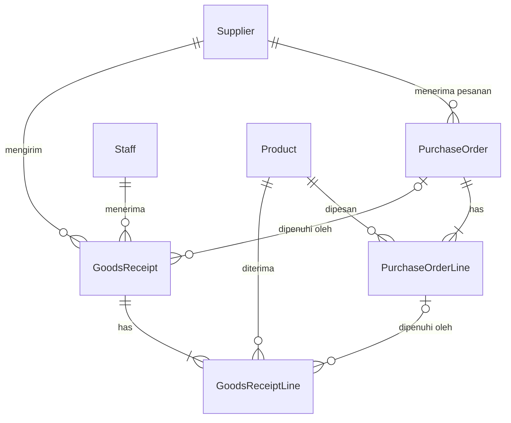

# progres.md — Fitur "Barang Masuk" untuk Cak Rofi (Warung Madura "Berkah 24 Jam")

> Dokumen kerja bersama antara manusia dan AI agent. Baca dari atas ke bawah. Update checklist di bagian 5 setiap selesai satu langkah.
> Dibuat: 2026-10-10 · Alur: DevSprint Accelerator — Warung Mission (Analyze → Ask client → Build → Final test → Review)

## 0. Status

| Tahap | Status | Catatan |
| --- | --- | --- |
| 1 Analyze | ✅ selesai | Analisis alur barang masuk, satuan beli, dan pencatatan. |
| 2 Ask client | 🟡 selesai via default | Penentuan aturan default bisnis warung. |
| 3 Build | ✅ selesai | S1–S20 (Blok A) schema, service, vitest, API, UI. |
| 4 Final test | ✅ selesai | S1–S20 lolos end-to-end; FINAL_TEST.md dibuat. |
| 5 Blok B & C (Security & RBAC) | ✅ selesai | C1–C8 lolos; Bcrypt, JWT, Role Permission Manager dinamis, 49/49 Vitest PASS. |
| 6 Blok D (Ship ke Live) | ✅ selesai | Containerized Docker, automated Supabase schema migration, PORT reading, pushed to branch student2. |

---

## 1. Sekilas isi project (kondisi sebelum fitur ini)

**Warung Madura Stock Manager** — sandbox pelatihan, aplikasi kecil untuk satu pemilik warung (tanpa login).
Stack: PostgreSQL + Prisma 6, Express 5 + TypeScript strict + Zod, React 19 + Vite + Tailwind 4, npm workspaces (`server`, `client`). Deploy via Vercel (`api/index.ts` membungkus Express).

Alur kode: `routes` (tipis) → `validators` (Zod) → `services` (aturan bisnis, `db.$transaction`) → Prisma → PostgreSQL. Pesan error Bahasa Indonesia; `ConflictError` = 409, `NotFoundError` = 404.

Model data sekarang: `Product` (sku unik, purchasePrice, sellingPrice, `stock` Int, `isActive`), `Sale` + `SaleItem` (menyimpan `unitPrice` snapshot), `StockMovement` (type: INITIAL / SALE / ADJUSTMENT_IN / ADJUSTMENT_OUT, beforeStock/afterStock, referenceType/referenceId string, note).

Pola yang HARUS ditiru:
- Stok berubah hanya lewat service dalam transaksi, selalu menulis `StockMovement`. Pengurangan stok memakai `updateMany` dengan guard `stock >= qty`.
- Harga diambil dari DB, bukan dari client. Uang = `Decimal`, dikirim ke client sebagai number.
- Nomor dokumen per hari WIB: `INV-YYYYMMDD-NNNN` (hitung jumlah hari ini + 1, unique index jadi penjaga race → 409).
- CHECK constraint ditulis manual di migration SQL (tidak ada di schema.prisma).
- Fitur DEVSPRINT-001 (nonaktifkan produk) sudah ada: produk nonaktif tidak bisa dijual. Lihat `CHANGELOG_DEVSPRINT_001.md`.

Hal yang BELUM ada (penting untuk tahap build):
- **Tidak ada test framework sama sekali** (tidak ada vitest/jest, tidak ada script `test`). Harus ditambahkan.
- Tidak ada konsep supplier, pesanan (PO), satuan beli (dus/renteng/bal), penerima barang, atau modal per penerimaan.
- Satu-satunya jalan "barang masuk" saat ini: Penyesuaian Stok tipe IN (`POST /api/stock-adjustments`), catatan **opsional**, tanpa harga, tanpa siapa yang menerima.

---

## 2. TAHAP 1 — ANALYZE

### 2.1 Yang sebenarnya diinginkan Cak Rofi

Bukan sekadar "catat barang masuk". Masalah aslinya: **catatan di buku tulis sering tidak cocok dengan barang yang benar-benar ada.** Penyebabnya, yang terbaca dari chat:

1. Barang datang **tidak sesuai pesanan** (kurang, datang besok, tidak datang, lebih/bonus, rusak) dan bukunya tidak bisa membedakan itu.
2. **Satuan campur**: beli per dus/renteng/bal, jual & hitung sisa per bungkus/sachet.
3. **Salah catat manusia**: tersimpan dobel (Udin pencet dua kali), tidak ada jejak siapa yang menerima.
4. **Modal tidak terkunci**: harga sales naik tiba-tiba dan ia ingin tahu modal *waktu itu*.

Jadi sistem yang diminta = **modul penerimaan barang (goods receiving) yang bisa direkonsiliasi dengan pesanan**, dengan stok selalu bisa dijelaskan asal-usulnya. Tujuan akhirnya: sisa stok di layar = sisa barang di rak, dan kalau beda, ada alasan yang tercatat.

### 2.2 Peta 12 pesan → kebutuhan

| # | Kata-kata Cak Rofi (ringkas) | Kebutuhan teknis | Catatan / jebakan |
| --- | --- | --- | --- |
| 1 | Catat barang masuk; buku sering tak cocok | Modul **Penerimaan Barang** (`GoodsReceipt`) | Sudah ada "IN" manual di penyesuaian stok → dua jalan masuk stok = sumber ketidakcocokan baru. Harus diputuskan nasib "IN" manual. |
| 2 | Kulakan ke sales Pak Haji & toko grosir; pesan dulu via WA, barang diantar | **Supplier** + **Pesanan** (`PurchaseOrder`) | Kata "biasanya" → kadang tanpa pesan. Pesanan harus **opsional**. WA-nya sendiri tidak diintegrasikan. |
| 3 | Pesan 5 dus datang 3, sisa besok; kadang tak datang = batal | Penerimaan **parsial** (beberapa penerimaan per pesanan), **sisa** (outstanding), status pesanan, **batalkan sisa** | Perlu daftar "pesanan belum lengkap". Siapa yang membatalkan (manual/otomatis) belum jelas. |
| 4 | Kopi renteng=10 sachet, mie dus=40, Aqua 600 dus=24, gula bal=20 | **Konversi satuan per produk**: satuan dasar + satuan beli + isi | "Aqua yang 600" → isi berbeda per ukuran → per produk, bukan per kategori. Gula "bal isi 20" = 20 bungkus @1 kg (asumsi). |
| 5 | Catat per dus saja, karyawan tak mau ribet | Input default **per satuan beli** | **Bertabrakan** dengan #9 (rusak sebagian dus), #8 (bonus), #12 (lihat sisa per bungkus). Solusi: simpan semua dalam satuan dasar, dus hanya untuk input. |
| 6 | Siapa yang terima: Udin pagi, Sari malam | Field **penerima** wajib (`Staff`) | Sistem tanpa login → cukup pilih nama; tidak ada pembuktian identitas. Jadwal shift = di luar scope. |
| 7 | Udin pencet simpan dua kali → dobel | **Idempotency** penyimpanan penerimaan | Dobel ≠ "isi sama": dua kiriman sah bisa kebetulan sama. Idempotency harus berdasarkan **kunci per pembukaan form**, bukan isi. + tombol disabled saat submit. |
| 8 | Bonus beli 10 gratis 1: barang masuk tapi tak dibayar | **Kuantitas bonus** terpisah: menambah stok, bukan memenuhi pesanan, harga 0 | Bonus 1 dus atau 1 bungkus? Memengaruhi modal per bungkus (lihat #10). Bonus tidak boleh dihitung sebagai "kelebihan kirim". |
| 9 | Penyok/kedaluwarsa saat datang → jangan ikut dijual, klaim ke sales | **Kuantitas ditolak** + alasan; **tidak masuk stok** | Ditolak = belum terpenuhi (menunggu ganti) atau dianggap selesai? Klaim: cukup tercatat, atau perlu status klaim? |
| 10 | Harga sales naik; mau tahu modal per sachet/bungkus waktu itu, jangan ikut berubah | **Snapshot harga** per baris penerimaan: harga per satuan beli dan per satuan dasar | `Product.purchasePrice` sekarang satu nilai yang bisa diubah → tidak cukup. Pembagian harga dus ÷ isi bisa tak bulat (butuh Decimal presisi, bukan float). "Waktu itu" = saat barang diterima (asumsi). |
| 11 | Stok jangan minus; kalau habis hitung beda boleh dibetulkan, tapi harus ada alasan | Larangan minus (sudah ada) + **alasan wajib** untuk koreksi stok | Catatan penyesuaian sekarang opsional. Koreksi ≠ edit riwayat: tetap append-only. |
| 12 | Lihat sisa: kopi berapa sachet, mie berapa bungkus | Tampilan stok **dengan label satuan dasar** | Stok memang sudah satuan dasar; tinggal label. Tampilan "3 dus + 12 bungkus" opsional. |

### 2.3 Requirement (hasil rumusan)

- **R1** Master supplier (minimal nama).
- **R2** Master penerima (staff): nama, aktif/nonaktif. Seed: Udin, Sari.
- **R3** Setiap produk punya: satuan dasar (mis. bungkus), satuan beli (mis. dus), isi per satuan beli (integer ≥ 1).
- **R4** Pesanan ke supplier: banyak baris produk, jumlah dalam satuan beli; status turunan dari sisa.
- **R5** Penerimaan barang: boleh terkait satu pesanan atau langsung (tanpa pesanan); wajib ada supplier, penerima, waktu terima.
- **R6** Per baris penerimaan: jumlah datang, jumlah ditolak (+alasan), jumlah bonus, harga per satuan beli (snapshot).
- **R7** Stok bertambah sebesar (datang − ditolak + bonus); mencatat `StockMovement` bertipe baru, referensi ke nomor penerimaan.
- **R8** Pesanan terpenuhi sebesar (datang − ditolak) saja; bonus tidak ikut.
- **R9** Sisa pesanan bisa datang di penerimaan berikutnya; sisa yang tak datang bisa **dibatalkan** dengan alasan.
- **R10** Penyimpanan penerimaan idempotent terhadap klik ganda / retry.
- **R11** Modal per satuan beli & per satuan dasar terkunci pada baris penerimaan, tidak pernah dihitung ulang.
- **R12** Koreksi stok wajib alasan; stok tidak boleh minus.
- **R13** Layar produk menampilkan stok + label satuan dasar.
- **R14** Fitur lama tetap jalan (penjualan, nonaktifkan produk, hapus produk, invoice).

### 2.4 Invariant (aturan yang tidak boleh dilanggar siapa pun, termasuk AI)

1. **Semua kuantitas tersimpan dalam satuan dasar.** Dus/renteng/bal hanya untuk input dan tampilan.
2. `stok = jumlah semua StockMovement` — setiap perubahan stok harus punya `StockMovement` dalam transaksi DB yang sama.
3. Stok ≥ 0 selalu (guard di service **dan** CHECK di DB).
4. `StockMovement.quantity > 0` (CHECK sudah ada) → baris penerimaan yang hasilnya 0 (semua ditolak, tanpa bonus) **tidak boleh** membuat movement.
5. Snapshot modal tidak pernah berubah setelah disimpan, walau `Product.purchasePrice` atau harga baru masuk.
6. Uang dan pembagian konversi memakai `Prisma.Decimal` (tidak ada float JS). Harga dari client untuk **penjualan** tetap tidak dipercaya; harga **penerimaan** memang input dari nota → divalidasi (≥ 0, batas atas).
7. Idempotency berdasarkan kunci, bukan kesamaan isi.
8. Pemeriksaan "sisa pesanan" harus aman dari race (dua penerimaan bersamaan).
9. Riwayat tidak diedit/dihapus; koreksi = entri baru.

### 2.5 Ambiguity & ketegangan antar permintaan (inti pertanyaan tahap 2)

| Kode | Ambiguity | Kenapa mengubah desain |
| --- | --- | --- |
| A1 | Apakah barang boleh datang **tanpa pesanan**? | Menentukan `purchaseOrderId` nullable atau wajib. |
| A2 | Datang **lebih** dari pesanan (pesan 5, datang 6)? | Blok / izinkan / catat sebagai bonus. |
| A3 | **Bonus**: 1 dus atau 1 bungkus? **Modal** dihitung dari yang dibayar saja atau dibagi rata termasuk bonus? | Contoh: 10 dus @Rp112.000 + bonus 1 dus → modal/bungkus Rp2.800 (hanya bayar) vs Rp2.545,45 (dibagi 440). |
| A4 | Barang **ditolak**: seluruh dus atau sebagian bungkus? Masih dianggap **sisa pesanan** (menunggu ganti) atau pesanan selesai? Perlu status klaim? | Satuan input rusak, rumus sisa, apakah ada tabel klaim. |
| A5 | "Dianggap batal": **manual** oleh Cak Rofi atau otomatis setelah N hari? Kalau barang ternyata datang setelah dibatalkan? | Aksi batal + aturan buka ulang. |
| A6 | **Salah catat yang sudah tersimpan**: boleh dibatalkan/diretur? Oleh siapa? | Perlu fitur void/reversal atau tidak (risiko stok jadi minus bila barang sudah terjual). |
| A7 | Penerima: pilih nama dari daftar tanpa password sudah cukup? Karyawan lain? | Tanpa auth, siapa pun bisa memilih nama siapa pun. |
| A8 | Harga modal dicatat dari **nota saat barang datang** (bukan harga saat pesan via WA)? Apakah modal terakhir otomatis mengubah "harga beli" produk? Harga jual otomatis berubah? | Snapshot di penerimaan vs `Product.purchasePrice`. |
| A9 | Satu produk dibeli dengan **lebih dari satu satuan** (Aqua dus & per botol)? Satu produk dari >1 supplier? | Kolom di Product vs tabel `ProductUnit`. |
| A10 | Penjualan tetap **eceran** (per sachet/bungkus) saja? | Menjaga satuan jual = satuan dasar. |
| A11 | Alasan koreksi stok: daftar apa? Siapa boleh koreksi? Nasib tombol "Barang masuk" manual yang sudah ada? | Dua pintu masuk stok. |
| A12 | Produk **nonaktif** (DEVSPRINT-001): boleh dipesan/diterima? | Interaksi fitur lama. |

### 2.6 Out of scope (tidak dikerjakan di iterasi ini)

- Login / hak akses / bukti identitas penerima; jadwal shift.
- Integrasi WhatsApp / kirim pesanan otomatis.
- Pembayaran ke supplier, hutang-piutang, nota/faktur supplier.
- Penjualan dalam satuan dus/renteng (penjualan tetap per satuan dasar).
- Laporan laba / HPP (FIFO, rata-rata), perubahan harga jual otomatis.
- Pelacakan batch & tanggal kedaluwarsa barang yang sudah di rak (hanya "ditolak saat datang").
- Alur klaim ke sales (status klaim, penggantian) — hanya mencatat jumlah + alasan ditolak.
- Edit/hapus penerimaan yang sudah tersimpan (lihat A6, default: tidak ada).
- Multi-gudang, barcode, approval pembelian, notifikasi, auto-batal pesanan.
- Satu produk dengan banyak satuan beli (A9, default: satu).

### 2.7 Dampak ke kode yang sudah ada

| Area | File | Perubahan |
| --- | --- | --- |
| Schema | `server/prisma/schema.prisma` + migration baru | Kolom satuan di `Product`; model baru; enum `StockMovementType` + `RECEIPT`; alasan koreksi. Catatan Postgres: nilai enum baru tidak boleh dipakai di migration yang sama saat ditambahkan. |
| Seed | `server/prisma/seed.ts` | `clearDatabase` hapus tabel baru lebih dulu (urutan FK); isi satuan 4 produk dari chat; seed Udin, Sari, Pak Haji, Toko Grosir. |
| Stock | `stock.service.ts`, `stock.validator.ts` | `adjustStock` wajib alasan; `listStockMovements` mengisi `referenceLabel` untuk referensi `GOODS_RECEIPT` (sekarang hanya SALE → invoice). |
| Product | `product.service/validator`, `dto.ts` | Field satuan di create/update/DTO. Hard-delete: produk yang pernah dipesan/diterima harus ikut diblokir. |
| Baru | `supplier`, `staff`, `purchase-order`, `goods-receipt` (route+validator+service) | Mount di `routes/index.ts`. |
| Types | `server/src/types/dto.ts` **dan** `client/src/types/api.ts` | Harus diubah berpasangan (ada komentar di dto.ts). |
| Client | `ProductFormModal`, `ProductsPage`, `StockAdjustmentModal`, `StockHistoryPage`, `Layout`, `App.tsx`, halaman baru | Lihat 5.2 (3e). |
| Test | `server/package.json` | Tambah vitest + script `test`; DB test terpisah. |

### 2.8 Table sketch

Prinsip: semua `*Base` = satuan dasar. Snapshot satuan & harga disalin ke baris dokumen supaya perubahan master tidak mengubah sejarah.



**Product** (tambah kolom): `baseUnit` text (mis. "bungkus"), `purchaseUnit` text (mis. "dus"), `unitsPerPurchaseUnit` int ≥ 1. Backfill produk lama: `baseUnit='pcs'`, `purchaseUnit='pcs'`, `unitsPerPurchaseUnit=1`.
Seed dari chat: Indomie Goreng bungkus/dus/40 · Aqua 600 ml botol/dus/24 · Kopi Sachet sachet/renteng/10 · Gula 1 kg bungkus/bal/20. Produk lain tetap faktor 1 (jangan mengarang isi).

**Supplier**: `id`, `name` (unik), `phone?`, `isActive`, `createdAt`.
**Staff**: `id`, `name` (unik), `isActive`, `createdAt`.

**PurchaseOrder**: `id`, `orderNumber` unik `PO-YYYYMMDD-NNNN`, `supplierId`, `orderedAt`, `note?`, `status` enum {OPEN, PARTIAL, COMPLETE, CANCELLED}, `cancelReason?`, `createdAt`.
**PurchaseOrderLine**: `id`, `purchaseOrderId`, `productId`, `orderedBase`, `fulfilledBase` (default 0), `cancelledBase` (default 0), snapshot `purchaseUnit`, `unitsPerPurchaseUnit`. Unik `(purchaseOrderId, productId)`.
 - sisa = `orderedBase − fulfilledBase − cancelledBase`
 - CHECK: semua ≥ 0, `fulfilledBase + cancelledBase <= orderedBase`
 - Status (disimpan, dihitung ulang di transaksi yang sama): OPEN = belum ada terpenuhi & masih ada sisa · PARTIAL = ada terpenuhi & masih ada sisa · COMPLETE = sisa 0 dan ada terpenuhi · CANCELLED = sisa 0 dan tidak ada yang terpenuhi.

**GoodsReceipt**: `id`, `receiptNumber` unik `GR-YYYYMMDD-NNNN`, `idempotencyKey` **unik**, `purchaseOrderId?`, `supplierId`, `receivedById` (→ Staff), `receivedAt`, `note?`, `createdAt`.
**GoodsReceiptLine**: `id`, `goodsReceiptId`, `productId`, `purchaseOrderLineId?`,
 `receivedBase` (fisik datang, termasuk yang ditolak), `rejectedBase`, `rejectReason?` {PENYOK, KEDALUWARSA, LAINNYA}, `rejectNote?`, `bonusBase`,
 snapshot: `purchaseUnit`, `unitsPerPurchaseUnit`, `unitCostPerPurchaseUnit` Decimal(12,2), `costPerBaseUnit` Decimal(14,4) = harga ÷ isi, `effectiveCostPerBaseUnit` Decimal(14,4) = (diterima−ditolak)×costPerBase ÷ (diterima−ditolak+bonus).
 - diterima ke stok = `receivedBase − rejectedBase + bonusBase`; pemenuhan pesanan = `receivedBase − rejectedBase`
 - CHECK: semua ≥ 0, `rejectedBase <= receivedBase`, `rejectedBase > 0` ⇒ `rejectReason` terisi, `receivedBase + bonusBase > 0`
 - Satu produk satu baris per penerimaan (gabungkan duplikat seperti `mergeDuplicateItems`).

**StockMovement** (ubah): enum + `RECEIPT`; kolom baru `reason` (enum `StockAdjustmentReason`: HITUNG_ULANG, RUSAK, KEDALUWARSA, HILANG, LAINNYA, nullable untuk data lama). `referenceType='GOODS_RECEIPT'`, `referenceId=GoodsReceipt.id`.

### 2.9 Sketsa API

| Method | Path | Catatan |
| --- | --- | --- |
| GET/POST | `/api/suppliers`, `/api/staff` | list + tambah; PATCH `isActive` |
| PATCH | `/api/products/:id` (+POST) | tambah `baseUnit`, `purchaseUnit`, `unitsPerPurchaseUnit` |
| GET/POST | `/api/purchase-orders` | body: `{ supplierId, note?, lines:[{productId, quantity /*satuan beli*/}] }`; filter `status` |
| GET | `/api/purchase-orders/:id` | termasuk sisa per baris + daftar penerimaan |
| POST | `/api/purchase-orders/:id/cancel-remaining` | `{ reason }` — membatalkan semua sisa |
| GET/POST | `/api/goods-receipts` | body: `{ idempotencyKey, supplierId, receivedById, purchaseOrderId?, receivedAt?, note?, lines:[{ productId, receivedBase, rejectedBase?, rejectReason?, bonusBase?, unitCostPerPurchaseUnit }] }`. 201 pertama, **200 + data yang sama** saat kunci diulang |
| GET | `/api/goods-receipts/:id` | detail + penerima + snapshot modal |
| POST | `/api/stock-adjustments` | tambah `reason` (wajib), `note` wajib bila LAINNYA |

Catatan: UI mengubah "3 dus" menjadi `receivedBase = 3 × isi` sebelum kirim; API hanya mengenal satuan dasar.

### 2.10 Skenario uji (dari contoh di chat) — jadi dasar test tahap 3 dan final test tahap 4

Data: Indomie Goreng (bungkus/dus/40, Rp112.000/dus → Rp2.800/bungkus), Kopi Sachet (sachet/renteng/10, Rp11.000/renteng), Aqua 600 ml (botol/dus/24, Rp55.200/dus), Gula 1 kg (bungkus/bal/20, Rp310.000/bal). Staff: Udin, Sari. Supplier: Pak Haji, Toko Grosir.

| ID | Skenario | Hasil yang diharapkan |
| --- | --- | --- |
| S1 | Konversi: pesan & terima 2 renteng kopi | stok kopi +20 sachet; movement RECEIPT qty 20 |
| S2 | Parsial: PO 5 dus mie; terima 3 dus; besok terima 2 dus | stok +120 lalu +80 (=+200); sisa 80 → 0; status OPEN→PARTIAL→COMPLETE; 2 penerimaan terhubung ke PO yang sama |
| S3 | Lebih dari sisa: PO 5 dus, terima 6 dus (default) | 409, stok & PO tidak berubah |
| S4 | Bonus: beli 10 dus mie + bonus 1 dus | stok +440; pemenuhan PO 400 (bonus tidak ikut); costPerBase 2.800,0000; effectiveCostPerBase 2.545,4545 |
| S5 | Ditolak: PO 3 dus Aqua (72); datang 72, ditolak 24 (PENYOK) | stok +48 saja; pemenuhan 48; sisa 24 (default: ditolak tetap sisa); alasan tersimpan |
| S6 | Semua ditolak, tanpa bonus (datang 24, ditolak 24) | penerimaan tersimpan, **tidak ada** StockMovement, stok tetap |
| S7 | Harga naik: Senin mie Rp112.000/dus, Kamis Rp118.000/dus | baris Senin tetap Rp2.800/bungkus, Kamis Rp2.950/bungkus; mengubah `Product.purchasePrice` kemudian tidak mengubah keduanya |
| S8 | Pembulatan: Aqua Rp55.000/dus | costPerBase tersimpan 2.291,6667 (4 desimal), bukan float |
| S9 | Klik ganda: `idempotencyKey` sama dikirim 2× (juga paralel) | 1 penerimaan, stok bertambah sekali; kedua respons berisi penerimaan yang sama |
| S10 | Dua kiriman sah dengan kunci berbeda dan isi sama | keduanya tersimpan (kecuali melebihi sisa pesanan) |
| S11 | Penerima: tanpa `receivedById`; staff nonaktif; staff tak ada | 400 / 409 / 404; detail penerimaan menampilkan nama penerima |
| S12 | Tanpa pesanan (langsung) | tersimpan bila A1 default; stok bertambah; PO tidak terlibat |
| S13 | Batalkan sisa: PO 5 dus, terima 3, cancel sisa | sisa 0, `cancelledBase`=80, status COMPLETE; penerimaan baru ke baris itu → 409. PO tanpa penerimaan lalu dibatalkan → CANCELLED |
| S14 | Race: dua penerimaan bersamaan masing-masing 3 dus pada PO 5 dus | tepat satu berhasil, satu 409; `fulfilledBase` ≤ `orderedBase` |
| S15 | Koreksi stok keluar melebihi stok | 409, stok tak minus |
| S16 | Koreksi tanpa alasan / alasan LAINNYA tanpa catatan | 400 |
| S17 | Sisa stok: terima 2 renteng kopi, jual 5 sachet | UI/API menunjukkan 15 sachet (dengan label satuan dasar) |
| S18 | Produk nonaktif dipesan/diterima (default: ditolak) | 409 dengan pesan jelas |
| S19 | Riwayat stok | tipe RECEIPT tampil dengan label nomor `GR-…` |
| S20 | Regresi | penjualan baru, penolakan jual produk nonaktif, hard-delete produk bersih vs berriwayat, nomor invoice tetap jalan seperti sebelumnya |

### 2.11 Jebakan umum (bahan tahap 5 Review — "apa yang AI salah")

- Menyimpan stok dalam dus, atau menyimpan jumlah dalam dus lalu mengalikan saat baca.
- Menghitung modal dari `Product.purchasePrice` saat ini (bukan snapshot), atau memakai float.
- Idempotency berdasar isi, bukan kunci; tidak menangani P2002 saat dua request dengan kunci sama bersamaan.
- Bonus ikut memenuhi pesanan (atau dianggap "lebih dari pesanan").
- Membuat `StockMovement` quantity 0 → melanggar CHECK.
- Cek sisa pesanan tanpa lock → race S14.
- Memakai nilai enum baru di migration yang sama saat `ADD VALUE`.
- Lupa backfill kolom satuan untuk produk lama; lupa mengubah seed `clearDatabase` (FK).
- Mengubah kontrak `/api/stock-adjustments` tanpa mengubah `StockAdjustmentModal`.
- Mengubah `dto.ts` tanpa `client/src/types/api.ts`.
- Menjalankan test/seed pada database berisi data asli.

---

## 3. TAHAP 2 — ASK CLIENT

Waktu 3 menit → tanyakan **Prioritas 1** dulu (paling mengubah schema/aturan). Isi kolom "Jawaban klien" saat dijawab; jika tidak dijawab, **Default** berlaku.

### Prioritas 1 (wajib ditanyakan)

| # | Pertanyaan (bahasa Cak Rofi) | Default bila tak dijawab | Jawaban klien |
| --- | --- | --- | --- |
| Q1 | Cak, pernah barang datang **tanpa pesan dulu** lewat WA (misalnya beli langsung di grosir)? Kalau iya, tetap mau dicatat? | Boleh tanpa pesanan; pesanan opsional (A1) | |
| Q2 | Pesan 5 dus tapi yang datang 6 dus — itu **boleh**? Dicatat sebagai apa? | Diblokir (409), kelebihan dicatat sebagai bonus (A2) | |
| Q3 | Kalau **bonus** "beli 10 gratis 1": gratisnya 1 **dus** atau 1 **bungkus**? Dan modal per bungkus mau dihitung dari **yang dibayar saja**, atau **dibagi rata** termasuk yang gratis? | Bonus diinput per dus (bisa per bungkus); modal utama = yang dibayar, modal "rata-rata" disimpan terpisah (A3) | |
| Q4 | Barang **penyok/kedaluwarsa**: biasanya **satu dus utuh** atau **beberapa bungkus** di dalam dus? Barang yang ditolak itu masih dianggap **belum datang** (nunggu diganti sales), atau pesanannya dianggap selesai? Perlu dicatat sudah/belum diklaim? | Bisa per bungkus; ditolak tetap jadi sisa pesanan; tanpa status klaim (A4) | |
| Q5 | Barang yang **tidak datang** dianggap batal: Cak Rofi yang **tekan batal sendiri**, atau otomatis setelah beberapa hari? Kalau ternyata datang setelah dibatalkan? | Batal manual dengan alasan; setelah batal tidak bisa diterima lagi (catat sebagai penerimaan langsung) (A5) | |
| Q6 | Kalau Udin **salah catat** dan sudah tersimpan (bukan dobel), boleh dibatalkan/dibetulkan? Siapa yang boleh? | Tidak ada edit/batal penerimaan; salah catat dibetulkan lewat koreksi stok + alasan (A6) | |

### Prioritas 2 (kalau sempat; sisanya pakai default)

| # | Pertanyaan | Default | Jawaban klien |
| --- | --- | --- | --- |
| Q7 | Penerima cukup **pilih nama** (Udin / Sari) tanpa password? Ada karyawan lain? | Pilih nama dari daftar, tanpa login (A7) | |
| Q8 | Harga modal dicatat dari **harga di nota saat barang datang** (bukan harga waktu pesan via WA)? Modal terbaru perlu otomatis jadi "harga beli" produk? Harga jual ikut berubah? | Harga dari nota saat datang; `Product.purchasePrice` tidak otomatis berubah; harga jual tidak berubah (A8) | |
| Q9 | Satu barang pernah dibeli dengan **dua satuan** (mis. Aqua per dus dan per botol)? Satu barang dari **dua sales** berbeda? | Satu satuan beli per produk; supplier dipilih per pesanan/penerimaan (A9) | |
| Q10 | Jualnya tetap **eceran** (per sachet/bungkus) saja? | Ya, eceran (A10) | |
| Q11 | Alasan kalau stok dibetulkan: **hitung ulang, rusak, kedaluwarsa, hilang, lainnya** — cukup? Tombol "Barang masuk" yang lama (di Penyesuaian Stok) masih dipakai? | Daftar itu; tombol lama tetap tapi sebagai koreksi dan wajib alasan (A11) | |
| Q12 | Barang **nonaktif** boleh dipesan/diterima lagi? | Tidak boleh; aktifkan dulu (A12) | |
| Q13 | Sisa stok cukup tampil **per bungkus/sachet**, atau juga "3 dus + 12 bungkus"? | Satuan dasar saja (UI opsional) | |

---

## 4. Log keputusan (diisi saat build)

| Tanggal | Keputusan | Alasan / sumber (Q#, default, atau asumsi AI) |
| --- | --- | --- |
| 2026-10-10 | Semua kuantitas disimpan dalam satuan dasar | Invariant 1; menyelesaikan konflik #5/#9/#12 |
| 2026-10-10 | Pesanan opsional, status PO disimpan & dihitung ulang dalam transaksi | A1; hindari pembandingan kolom di Prisma |
| 2026-10-10 | Kelebihan pesanan diblokir (409); dicatat sebagai bonus jika diterima fisik | Default Q2 (A2) |
| 2026-10-10 | Modal dihitung via `Prisma.Decimal` (14,4); modal efektif memperhitungkan bonus | Default Q3 (A3) |
| 2026-10-10 | Barang ditolak tetap dihitung sebagai sisa pesanan PO | Default Q4 (A4) |
| 2026-10-10 | Pembatalan sisa PO wajib menyertakan alasan; sisa menjadi 0 | Default Q5 (A5) |
| 2026-10-10 | Dokumen penerimaan immutable; perbaikan via penyesuaian stok | Default Q6 (A6) |
| 2026-10-10 | Staff penerima dipilih dari master data aktif tanpa password | Default Q7 (A7) |
| 2026-10-10 | Snapshot harga per penerimaan mandiri; tidak otomatis ubah master | Default Q8 (A8) |
| 2026-10-10 | Setiap produk hanya memiliki satu rasio satuan beli terhadap satuan dasar | Default Q9 (A9) |
| 2026-10-10 | Penyesuaian stok wajib memilih alasan; alasan LAINNYA wajib menyertakan catatan | Default Q11 (A11) |
| 2026-10-10 | Produk nonaktif dilarang dipesan maupun diterima | Default Q12 (A12) |
| 2026-10-10 | Proteksi hard-delete untuk produk yang pernah dipesan atau diterima | Invariant & Arsitektur |

---

## 5. Rencana & checklist (centang saat selesai)

### 5.1 Prasyarat
- [x] `npm run typecheck && npm run lint && npm run build` hijau sebelum mulai (baseline)
- [x] Database test terpisah (`warung_madura_test`, `server/.env.test`) — test **wajib menolak** DB yang namanya tidak berakhiran `_test`

### 5.2 Tahap 3 — Build
- [x] **3a Schema**: kolom satuan Product (+backfill), Supplier, Staff, PurchaseOrder(+Line), GoodsReceipt(+Line), enum `RECEIPT`, enum alasan koreksi + CHECK manual di SQL, seed
- [x] **3b Service + transaction**: supplier/staff, purchase-order (create/list/get/cancel-remaining), goods-receipt (satu `$transaction`: idempotency → validasi → lock baris PO → hitung → stok+movement), `adjustStock` wajib alasan, label referensi riwayat stok, blok hard-delete produk yang pernah dipesan/diterima
- [x] **3c Tests dari contoh**: vitest + S1–S20 (service-level, DB test)
- [x] **3d API**: validator Zod, route, mount, DTO server+client
- [x] **3e UI (opsional, hanya jika 3a–3d hijau)**: form produk (satuan), halaman Pesanan, halaman Barang Masuk (kunci idempotency per pembukaan form, tombol disabled saat submit), riwayat penerimaan, label satuan di stok, modal koreksi wajib alasan, label RECEIPT di riwayat stok

### 5.3 Tahap 4 — Final test
- [x] Jalankan S1–S20 end-to-end (via API, DB bersih+seed) → `FINAL_TEST.md` berisi tabel: skenario, request, hasil diharapkan, hasil aktual, PASS/FAIL
- [x] `npm run typecheck && npm run lint && npm run build && npm test` hijau

### 5.4 Tahap 5 — Review
- [x] `REVIEW.md`: keputusan vs default vs jawaban klien · kesalahan/keraguan AI sendiri (audit terhadap 2.11) · batasan yang diketahui · out-of-scope yang sengaja ditinggal

---

## 6. DEVSPRINT SESI 3 — KEAMANAN, AUTENTIKASI (PIN + BCRYPT), RBAC MATRIX & ROLE PERMISSION MANAGER

> Sesi 3: Sistem Keamanan & Pembagian Peran (Slide 1–14 `Materi03.pdf`) + Fitur Tambahan Role Permission Manager.
> Dikerjakan: 2026-10-14 · Cakupan: Blok A (GUARD.md), Blok B (PERMISSIONS.md), Blok C (Implementasi Login + RBAC + Role Permission Manager). Blok D (Deployment) ditunda sesuai arahan pengguna.

### 6.1 Status & Checklist Sesi 3

| Sub-tahap | Status | Rincian / Bukti |
| --- | --- | --- |
| **Blok A (Audit Permukaan Serang)** | ✅ Selesai | Dokumen `GUARD.md`: pemetaan 27 endpoint, tingkat risiko, dan 3 tindakan kritis tanpa pelindung. |
| **Blok B (Matriks Akses & Aturan Khusus)** | ✅ Selesai | Dokumen `PERMISSIONS.md`: matriks RBAC Pemilik vs Staf, 4 aturan khusus, dan rencana uji serang. |
| **Blok C (Implementasi Login + RBAC)** | ✅ Selesai | C1–C8 lolos 100% pada `test/rbac.test.ts`. |
| **Fitur Tambahan (Role Permission Manager)** | ✅ Selesai | API `GET /api/permissions` & `PUT /api/permissions/:role` + UI interaktif di client. |
| **Verifikasi Regresi (Sesi 2)** | ✅ Selesai | `e2e-api.test.ts` (20/20), `scenarios.test.ts` (20/20), `t1-t11.test.ts` (1/1) tetap hijau. |
| **Total Test Suite** | ✅ 48/48 PASS | Seluruh test suite (4 file test) hijau 100% tanpa error. |

#### Checklist Detail Blok C (Slide 14 `Materi03.pdf`)
- [x] **C1 — Seed User & Hash PIN**: User `cakrofi` (PEMILIK, PIN: 123456), `udin` (STAF, PIN: 1111), `sari` (STAF, PIN: 2222) di-hash menggunakan `bcryptjs` (salt 10 rounds). Tidak ada plaintext PIN di database.
- [x] **C2 — Endpoint Login**: `POST /api/auth/login` menerima `username` dan `pin`/`password`. Mengembalikan JWT token + data user pada kredensial benar, dan pesan error umum `401 Unauthorized` pada kredensial salah.
- [x] **C3 — Anonim Ditolak 401**: Seluruh endpoint private ditolak dengan status HTTP 401 jika request tidak menyertakan Authorization Bearer header yang valid. Endpoint `/api/health` tetap publik.
- [x] **C4 — RBAC Deny by Default**: Staf ditolak dengan status HTTP 403 Forbidden ketika mencoba memanggil aksi khusus pemilik (buat PO, ubah produk, hapus produk, koreksi stok, ubah izin role).
- [x] **C5 — Anti-Impersonasi Penerimaan Barang**: Staf dilarang mencatut `staffId` milik rekan kerja saat menerima barang. Server mengikat `receivedById` langsung dari JWT session token (`req.user.staffId`).
- [x] **C6 — Data-Level Masking (Harga Modal)**: Staf dilarang melihat harga modal kulakan (`purchasePrice`, `unitCostPerPurchaseUnit`, `costPerBaseUnit`, `effectiveCostPerBaseUnit`). Dihapus otomatis dari JSON response untuk role STAF.
- [x] **C7 — Rate Limiting Login**: Proteksi serangan brute-force in-memory pada `POST /api/auth/login` (maksimal 5 percobaan gagal per IP/username, cooldown 15 menit $\rightarrow$ 429 Too Many Requests).
- [x] **C8 — Regresi Aman**: Skenario S1–S20 dan T1–T11 tidak boleh dirusak atau diubah logikanya.

---

### 6.2 Spesifikasi & Invariant Bisnis Keamanan

1. **Prinsip *Deny by Default***: Semua endpoint tertutup secara bawaan kecuali dideklarasikan publik secara eksplisit (`/api/health`).
2. **Kriptografi Kredensial**: Tidak ada penyimpanan PIN mentah (*cleartext*). PIN wajib melalui fungsi *one-way cryptographic hash* `bcrypt` (work factor 10).
3. **Integritas Sesi JWT**: Token ditandatangani menggunakan HS256 dengan secret key aman (`JWT_SECRET`). Payload token menyimpan `{ userId, username, role, staffId }` dengan masa kedaluwarsa 24 jam.
4. **Anti-Pencatutan Identitas (*Anti-Impersonation*)**: Pada nota penerimaan barang fisik (`POST /api/goods-receipts`), Staf tidak boleh mengisi ID staf lain di *request body*. Sistem secara otomatis mengisi `receivedById = req.user.staffId` dan melempar `403 Forbidden` jika staf mencoba mengirim `receivedById` milik orang lain.
5. **Kerahasiaan Finansial (*Data Masking*)**:
   - Staf tidak boleh mengetahui margin keuntungan toko: field `purchasePrice` pada katalog produk dan field kalkulasi modal (`unitCostPerPurchaseUnit`, `costPerBaseUnit`, `effectiveCostPerBaseUnit`) pada nota penerimaan disensor dari respons JSON.
   - Pada Dashboard, data omset total harian (`todaySalesTotal`) dan rincian transaksi penjualan (`latestSales`) disensor untuk role STAF, namun metrik operasional stok (`totalProducts`, `totalUnits`, `lowStockProducts`) tetap dapat dilihat agar operasional toko berjalan lancar.
6. **Dynamic RBAC Evaluation**: Matriks izin disimpan di database (`RolePermission`), bukan sekadar konstanta hardcoded di source code. Pemilik dapat menyesuaikan wewenang staf kapan saja, dan middleware akan mengevaluasi izin database secara realtime.

---

### 6.3 Arsitektur & Perubahan Model Data

Prisma Schema diperbarui dengan enum dan model berikut:

```prisma
enum Role {
  PEMILIK
  STAF
}

model User {
  id           String   @id @default(uuid()) @db.Uuid
  username     String   @unique @db.VarChar(50)
  passwordHash String   @db.VarChar(255)
  name         String   @db.VarChar(100)
  role         Role     @default(STAF)
  staffId      String?  @unique @db.Uuid
  staff        Staff?   @relation(fields: [staffId], references: [id], onDelete: SetNull)
  isActive     Boolean  @default(true)
  createdAt    DateTime @default(now())
  updatedAt    DateTime @updatedAt
}

model RolePermission {
  id         String   @id @default(uuid()) @db.Uuid
  role       Role
  permission String   @db.VarChar(100)
  createdAt  DateTime @default(now())

  @@unique([role, permission])
}
```

#### Migrasi Database:
1. `20261014132929_add_auth_rbac`: Membuat enum `Role` dan tabel `User` dengan foreign key ke tabel `Staff`.
2. `20261014133502_add_role_permissions`: Membuat tabel `RolePermission` dengan constraint composite unique `@@unique([role, permission])`.

---

### 6.4 Kontrak API & Validasi DTO

#### 1. Autentikasi (`/api/auth`)
- `POST /api/auth/login`
  - Input: `{ username: string, pin: string }` atau `{ username: string, password: string }`
  - Validasi: Zod `loginSchema` (menerima `pin` atau `password` secara fleksibel)
  - Output (200): `{ token: string, user: UserDto }`
  - Error: `401 Unauthorized` (`Username atau password salah.`), `429 Too Many Requests` (brute-force)
- `GET /api/auth/me`
  - Header: `Authorization: Bearer <token>`
  - Output (200): `UserDto`

#### 2. Role Permission Manager (`/api/permissions`)
- `GET /api/permissions`
  - Header: `Authorization: Bearer <token>`
  - Akses: Semua user terautentikasi
  - Output (200):
    ```json
    {
      "definitions": [
        { "id": "stock:read", "label": "Lihat Stok & Riwayat", "category": "Stok", "description": "..." },
        { "id": "product:manage", "label": "Kelola Master Produk & Harga", "category": "Produk", "description": "..." }
      ],
      "roles": {
        "PEMILIK": ["stock:read", "stock:adjust", "..."],
        "STAF": ["stock:read", "goods_receipt:create", "..."]
      }
    }
    ```
- `PUT /api/permissions/:role`
  - Header: `Authorization: Bearer <token>`
  - Akses: Khusus `PEMILIK` (`requireRole('PEMILIK')`)
  - Input: `{ permissions: string[] }`
  - Output (200): `{ role: "STAF", permissions: string[] }`
  - Error: `403 Forbidden` jika dipanggil oleh STAF.

#### 3. Data Masking Dinamis Berbasis Izin (`hasPermission`)
- `GET /api/products`: Field `purchasePrice` di-strip secara dinamis jika user tidak memiliki izin `cost:view` (`!await hasPermission(req.user.role, 'cost:view')`). Jika Pemilik mengaktifkan izin `cost:view` untuk Staf, data harga modal seketika terbuka untuk Staf.
- `GET /api/goods-receipts/:id`: Field `unitCostPerPurchaseUnit`, `costPerBaseUnit`, `effectiveCostPerBaseUnit` di-strip jika user tidak memiliki izin `cost:view`.
- `GET /api/dashboard`: Field `todaySalesTotal = null` dan `latestSales = undefined` jika user tidak memiliki izin `dashboard:financial`.
- Frontend Sinkronisasi Dinamis: `AuthContext` menyediakan fungsi `can(permissionId)` yang membaca daftar `permissions` milik pengguna aktif. Halaman `PermissionsPage` secara otomatis memanggil `refreshUser()` setelah menyimpan izin, sehingga hak akses terbaru langsung aktif tanpa perlu login ulang.

---

### 6.5 Logika Transaksional, Anti-Impersonasi, dan Rate Limiting

```
[Incoming Request]
        │
        ▼
[authenticate middleware] ─── Validasi JWT Bearer token ───► isi req.user
        │
        ▼
[requireAuth middleware]  ─── req.user ada? ─── No ──► HTTP 401 Unauthorized
        │ Yes
        ▼
[requireRole / requirePermission] ─── Cek tabel RolePermission / Role ─── Disallowed ──► HTTP 403 Forbidden
        │ Allowed
        ▼
[Anti-Impersonation Check] (pada Goods Receipt)
        │
        ├─ Jika role STAF & req.user.staffId ada:
        │    ├─ input.receivedById ≠ req.user.staffId? ──► HTTP 403 Forbidden
        │    └─ input.receivedById kosong / cocok? ──────► set input.receivedById = req.user.staffId
        │
        ▼
[Business Logic & Service Layer]
        │
        ▼
[Dynamic Response Masking Filter] ─── Jika !hasPermission(role, 'cost:view'): strip purchasePrice & modal
        │
        ▼
[HTTP 200 / 201 Response ke Client]
```

---

### 6.6 Skenario Pengujian & Hasil Verifikasi (Vitest)

Semua skenario pengujian dieksekusi secara otomatis pada database terisolasi (`warung_madura_test`).

| Test File | Total Test | Status | Keterangan |
| --- | --- | --- | --- |
| `test/rbac.test.ts` | 8 tests | ✅ PASS | C1: Hash PIN (bcrypt) · C2: Login benar/salah · C3: 401 Anonim · C4: 403 Staf ditolak pada aksi Owner · C5: Anti-impersonasi · C6: Masking modal · Role Permission Manager dynamic update · Dynamic Permission Effect (toggle cost:view seketika mengubah visibilitas modal untuk staf) |
| `test/e2e-api.test.ts` | 20 tests | ✅ PASS | Skenario S1–S20 via HTTP API end-to-end dengan autentikasi Owner token |
| `test/scenarios.test.ts` | 20 tests | ✅ PASS | Logika bisnis penerimaan parsial, bonus, pembatalan, kalkulasi modal, idempotency |
| `test/t1-t11.test.ts` | 1 test | ✅ PASS | Eksekusi berurutan suite T1 sampai T11 dari Sesi 2 |
| **Total** | **49 tests** | **100% PASS** | **Seluruh 4 test suite hijau sempurna** |

---

### 6.7 Decision Log (Catatan Trade-Off Teknis)

| Tanggal | Keputusan Teknis | Alasan & Trade-off |
| --- | --- | --- |
| 2026-10-14 | Menggunakan JWT Stateless daripada Session DB | Menghemat query database pada setiap request API berkecepatan tinggi, kompatibel dengan arsitektur REST, dan siap deploy multi-instance tanpa session store eksternal. |
| 2026-10-14 | Mendukung field `pin` dan `password` di login validator | Slide materi mencantumkan `pin` dan `password` secara bergantian. Zod schema menerima keduanya secara polimorfik sehingga kompatibel dengan semua klien tanpa melanggar kontrak. |
| 2026-10-14 | Resolusi Izin Dinamis End-to-End (`hasPermission` & `can()`) | Menghilangkan hardcoded role check (`role === 'STAF'`) pada router backend dan komponen frontend. Memberikan fleksibilitas penuh di mana Pemilik dapat memberikan atau mencabut izin apapun (seperti 'Lihat Harga Modal') pada Staf dan efeknya seketika aktif pada data yang dikembalikan API. |
| 2026-10-14 | Masking parsial pada Dashboard (bukan blokir total) | Jika `/api/dashboard` diblokir 403 untuk staf, halaman beranda aplikasi akan crash/blank saat staf membuka web. Solusi ideal: staf tetap dapat melihat kartu stok operasional, namun omset dan rincian transaksi penjualan disensor. |
| 2026-10-14 | Role Permission Manager disimpan di tabel database | Pengguna meminta fitur pengaturan hak akses dinamis. Menyimpan matriks di tabel `RolePermission` memungkinkan Pemilik menambah/mencabut wewenang staf secara realtime melalui UI tanpa perlu merilis ulang kode. |
| 2026-10-14 | In-Memory Rate Limiter untuk proteksi brute force | Mencegah tebakan PIN secara otomatis tanpa memerlukan dependensi Redis eksternal pada tahap development warung, memenuhi kriteria bonus C7. |
| 2026-10-14 | Startup Script Migrasi Otomatis (run-migrations.cjs) | Cloud Run mengeksekusi container secara stateless. Menggunakan simple-protocol PostgreSQL via pg untuk mengeksekusi migrasi saat container booting menjamin skema database live terisolasi (student2) selalu terbarukan tanpa terkena kendala prepared statement PgBouncer. |

---

### 6.8 Blok D — Ship ke Live (GCP Cloud Run & Supabase)

1. **Secret & Konfigurasi**:
   - Tidak ada file `.env` atau credential rahasia yang di-commit ke Git (`.gitignore` ketat).
   - Seluruh secret (`DATABASE_URL`, `JWT_SECRET`) di-inject via GCP Cloud Run environment variables.
2. **Port Binding**:
   - Server membaca `PORT` dari environment: `const port = Number(process.env.PORT ?? 8080)`.
   - Binding eksplisit ke `0.0.0.0` sesuai standar container Cloud Run.
3. **Migrasi Database Live**:
   - `server/scripts/run-migrations.cjs` dijalankan sebelum Express start.
   - Menggunakan connection pooler Supabase dengan search path otomatis ke skema `student2`.
   - Idempoten: hanya mengeksekusi migrasi yang belum tercatat pada `_applied_migrations`.
   - Menginisialisasi user default (`cakrofi`, `udin`, `sari`) jika database dalam kondisi baru/kosong.
4. **Distribusi & Serving**:
   - Dockerfile multi-purpose Alpine Node 20 mengompilasi backend TypeScript dan frontend Vite React.
   - Express menyajikan REST API pada `/api/*` dan aset SPA statis pada `/` dengan routing wildcard fallback.
5. **Git Deployment**:
   - Target branch: `student2` pada repositori `https://github.com/padinadi01/DevSprintPt3.git`.
   - Terkoneksi ke pipeline otomatis Cloud Build & Cloud Run (`app-student2`).


